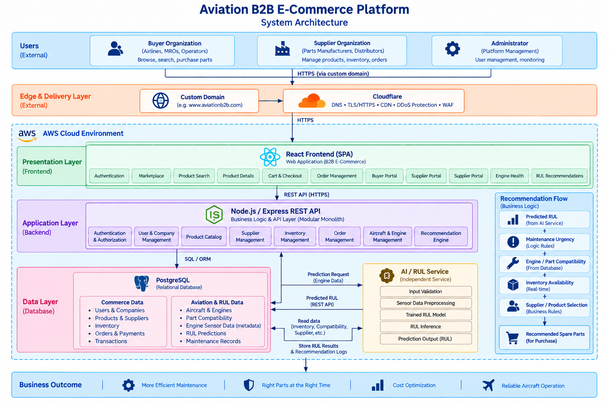

# AeroRUL — System Architecture

## 1. Overview

AeroRUL is an AI-enhanced B2B aviation parts marketplace that connects airlines
and Maintenance, Repair, and Overhaul (MRO) organizations with aviation parts
suppliers.

The platform integrates conventional B2B procurement with Remaining Useful Life
(RUL) predictions to support maintenance planning and replacement-part
recommendations.

The system is organized around a **React/Vite frontend, a
Node.js/Express modular monolith, PostgreSQL transactional storage, and an
independent Python/FastAPI inference service**.

The architecture separates user interfaces, business logic, persistent data,
and AI inference while maintaining a single backend entry point for application
operations.

## 2. Master System Architecture

The diagram illustrates the primary system components, their responsibilities,
and communication boundaries.

The complete architecture is maintained in one editable draw.io file:

[**Open System Design — draw.io**](./system-design.drawio)

The diagram exports for direct review are available in [./diagrams](./diagrams):

- [00 — Master System Architecture](<./diagrams/System_Design_ver 1.0-00 Master System Architecture.drawio.svg>)
- [01 — Business & User Workflows](<./diagrams/System_Design_ver 1.0-01 Business & User Workflows.drawio.svg>)
- [02 — Frontend Architecture](<./diagrams/System_Design_ver 1.0-02 Frontend Architecture.drawio.svg>)
- [03 — REST API & Backend](<./diagrams/System_Design_ver 1.0-03 REST API & Backend.drawio.svg>)
- [04 — PostgreSQL OLTP](<./diagrams/System_Design_ver 1.0-04 PostgreSQL OLTP (26 tables).drawio.svg>)
- [05 — AI/RUL & Recommendation](<./diagrams/System_Design_ver 1.0-05 AI-RUL & Recommendation.drawio.svg>)
- [06 — Deployment & Runtime](<./diagrams/System_Design_ver 1.0-06 Deployment & Runtime.drawio.svg>)
- [07 — End-to-End Integration](<./diagrams/System_Design_ver 1.0-07 End-to-End Integration.drawio.svg>)

## 3. Core Business Flows

AeroRUL supports two procurement paths that converge into the same cart and
checkout process.

### Path A — Standard B2B Procurement

**Buyer → Marketplace → Product & Supplier Listings → Shared Cart → Checkout
→ Order Fulfillment**

Buyers browse aviation parts, compare available supplier listings, and place
orders through the marketplace.

### Path B — AI-Assisted Procurement

**Buyer → Aircraft Engine → Sensor Data Upload → RUL Inference → Replacement
Recommendations → Shared Cart → Checkout**

Buyers upload engine sensor data to obtain RUL predictions. The backend combines
prediction results with compatibility information and available supplier
listings to generate replacement recommendations.

Both paths use the same checkout transaction and order-processing workflow.

## 4. Architecture Components

### Frontend — React/Vite

The frontend provides role-based interfaces for buyers, suppliers, and
administrators.

Core functionality includes marketplace browsing, supplier listings, cart and
checkout, order management, engine management, RUL analysis, and replacement
recommendations.

The React application communicates with the Express backend through HTTP REST
APIs. It does not connect directly to PostgreSQL or the FastAPI inference
service.

### Backend — Node.js/Express

The backend follows a **modular monolith** architecture. All business modules
operate within one Express application rather than independently deployed
microservices.

Its responsibilities include authentication, organization-based access
control, catalog and supplier listings, inventory, cart and checkout, order
fulfillment, fleet management, RUL orchestration, and replacement
recommendations.

The backend is the main application API and coordinates database operations and
external service communication.

### Database — PostgreSQL

PostgreSQL provides persistent OLTP storage for the marketplace and
aviation-related application data.

The database design contains **26 tables** grouped into identity and
organizations, catalog and stock, shopping, fleet, orders and fulfillment,
AI/RUL, and engagement domains.

The backend manages database access using parameterized SQL and a PostgreSQL
connection pool. Checkout operations use a shared database transaction to
coordinate order creation and inventory updates.

For schema details, see the [Database Documentation](../database/README.md).

### AI Inference — Python/FastAPI

The FastAPI service is responsible for processing sensor input and executing
the trained RUL model. Its responsibilities include input validation, sensor
preprocessing, model loading, and inference.

FastAPI returns prediction results to Express. It does not directly manage
orders, inventory, supplier listings, or PostgreSQL business transactions.

### Replacement Recommendation Logic

Replacement recommendations are managed by Express.

The recommendation process combines RUL predictions with engine-part
compatibility, active supplier listings, and inventory availability.
Recommended listings can be added to the same shopping cart used by standard
marketplace purchases.

The C-MAPSS-based RUL workflow uses demonstration data and must not be
interpreted as a certified aircraft maintenance diagnosis.

### Data Engineering

A separate offline data pipeline prepares aviation reference data and
marketplace seed records. The process follows:

**Bronze → Silver → Gold → PostgreSQL Seed Initialization**

This pipeline is separate from the runtime request flow and does not execute
during ordinary marketplace operations.

Detailed processing and dataset documentation are maintained in
[Data Engineering](../data/README.md).

## 5. Architecture Diagrams

The editable draw.io source contains eight pages, and each page has a matching SVG export in [./diagrams](./diagrams):

| Page | Diagram | Focus |
|---|---|---|
| 00 | [Master System Architecture](<./diagrams/System_Design_ver 1.0-00 Master System Architecture.drawio.svg>) | System boundaries and major components |
| 01 | [Business & User Workflows](<./diagrams/System_Design_ver 1.0-01 Business & User Workflows.drawio.svg>) | Buyer, supplier, admin, and AI-assisted procurement flows |
| 02 | [Frontend Architecture](<./diagrams/System_Design_ver 1.0-02 Frontend Architecture.drawio.svg>) | React application structure and user interfaces |
| 03 | [REST API & Backend](<./diagrams/System_Design_ver 1.0-03 REST API & Backend.drawio.svg>) | Middleware, backend modules, and dependencies |
| 04 | [PostgreSQL OLTP](<./diagrams/System_Design_ver 1.0-04 PostgreSQL OLTP (26 tables).drawio.svg>) | Database domains, tables, and relationships |
| 05 | [AI/RUL & Recommendation](<./diagrams/System_Design_ver 1.0-05 AI-RUL & Recommendation.drawio.svg>) | Inference and recommendation integration |
| 06 | [Deployment & Runtime](<./diagrams/System_Design_ver 1.0-06 Deployment & Runtime.drawio.svg>) | Hosting and runtime boundaries |
| 07 | [End-to-End Integration](<./diagrams/System_Design_ver 1.0-07 End-to-End Integration.drawio.svg>) | Cross-component request and data flows |

Offline ETL and data-init details are documented separately under [Data Engineering](../data/README.md).

## 6. Deployment Architecture

The architecture separates frontend hosting, backend execution, database
persistence, and AI inference.

| Component | Technology / Hosting |
|---|---|
| Frontend | React/Vite — Vercel |
| Backend | Node.js/Express — Render |
| Database | PostgreSQL — managed database hosting |
| AI Inference | Python/FastAPI — Docker container |
| Edge | Cloudflare DNS/TLS |
| Object Storage | Private storage for sensor files and model artifacts |

Hosting and storage configurations are documented separately in
[DevOps](../devops/README.md).

## 7. Related Documentation

- [Documentation Home](../README.md)
- [REST API](../api/README.md)
- [Database Design](../database/README.md)
- [Data Engineering](../data/README.md)
- [RUL Integration](../RUL_integration/README.md)
- [UI/UX Design](../ui-ux/README.md)
- [DevOps & Deployment](../devops/README.md)

## 8. Maintaining the Architecture

The editable [system-design.drawio](./system-design.drawio) file is the
authoritative source for system architecture diagrams.

When an architectural change is made, update the corresponding draw.io page,
regenerate its exported image, and revise any affected documentation in the
same commit.

The diagrams describe the intended system design; implementation details
should be verified against the source code and deployment configuration.
