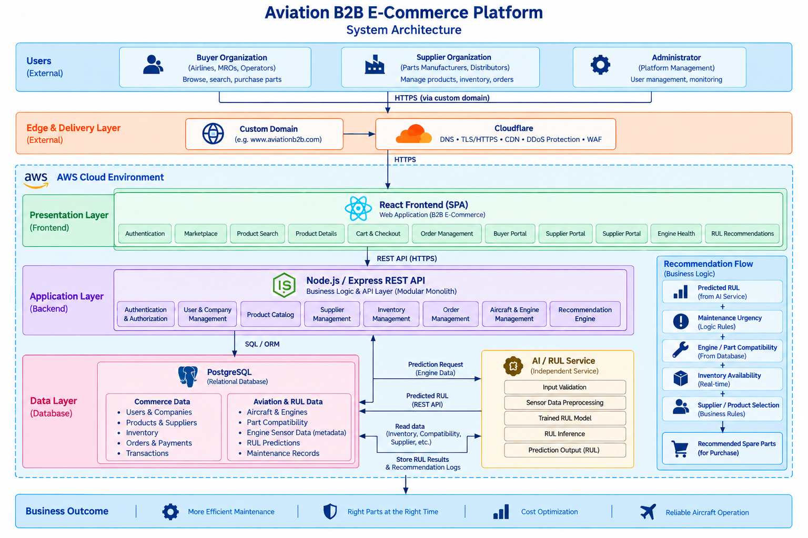

# AeroRUL — System Architecture

## 1. Overview

AeroRUL is an AI-enhanced B2B aviation parts marketplace that connects airlines
and Maintenance, Repair, and Overhaul (MRO) organizations with aviation parts
suppliers.

The platform integrates conventional B2B procurement with a simulated
Remaining Useful Life (RUL) workflow for educational maintenance planning.
RUL-based replacement recommendations are deferred.

The system is organized around a **React/Vite frontend, a
Node.js/Express modular monolith, PostgreSQL transactional storage, and a
private Python/FastAPI inference service for the integrated RUL model**.

The architecture separates user interfaces, business logic, persistent data,
and AI inference while maintaining a single backend entry point for application
operations.

## 2. Master System Architecture

The diagram illustrates the primary system components, their responsibilities,
and communication boundaries.

The complete architecture is maintained in one editable draw.io file:

[**Open System Design — draw.io**](./system-design.drawio)

The diagram exports for direct review are available in [./diagrams](./diagrams):

- [00 — Master System Architecture](<./diagrams/System_Design_ver 1.0-00 Master System Architecture.drawio.svg>)
- [01 — Business & User Workflows](<./diagrams/System_Design_ver 1.0-01 Business & User Workflows.drawio.svg>)
- [02 — Frontend Architecture](<./diagrams/System_Design_ver 1.0-02 Frontend Architecture.drawio.svg>)
- [03 — REST API & Backend](<./diagrams/System_Design_ver 1.0-03 REST API & Backend.drawio.svg>)
- [04 — PostgreSQL OLTP](<./diagrams/System_Design_ver 1.0-04 PostgreSQL OLTP (26 tables).drawio.svg>)
- [05 — AI/RUL & Recommendation](<./diagrams/System_Design_ver 1.0-05 AI-RUL & Recommendation.drawio.svg>)
- [06 — Deployment & Runtime](<./diagrams/System_Design_ver 1.0-06 Deployment & Runtime.drawio.svg>)
- [07 — End-to-End Integration](<./diagrams/System_Design_ver 1.0-07 End-to-End Integration.drawio.svg>)



## 3. Core Business Flows

AeroRUL supports two procurement paths that converge into the same cart and
checkout process.

### Path A — Standard B2B Procurement

**Buyer → Marketplace → Product & Supplier Listings → Shared Cart → Checkout
→ Order Fulfillment**

Buyers browse aviation parts, compare available supplier listings, and place
orders through the marketplace.

### Path B — Buyer RUL Simulation

**Buyer → Company Engine → FD002 Simulation CSV → RUL Inference → Saved
Prediction History**

Buyers associate a selected company-owned engine with one simulated NASA
C-MAPSS FD002 unit. The Express backend invokes the frozen Python model and
stores the successful prediction. This association does not establish that the
CSV is real aircraft telemetry or that a marketplace listing is compatible.
RUL-based replacement recommendations are deferred.

Standard procurement uses the shared cart and checkout. RUL results do not
automatically create orders, supplier recommendations, or compatibility
claims.

## 4. Architecture Components

### Frontend — React/Vite

The frontend provides role-based interfaces for buyers, suppliers, and
administrators.

Core functionality includes marketplace browsing, supplier listings, cart and
checkout, order management, engine management, and RUL analysis. RUL-based
replacement recommendations remain future work.

The React application communicates with the Express backend through HTTP REST
APIs. It does not connect directly to PostgreSQL or invoke the Python model.

### Backend — Node.js/Express

The backend follows a **modular monolith** architecture. All business modules
operate within one Express application rather than independently deployed
microservices.

Its responsibilities include authentication, organization-based access
control, catalog and supplier listings, inventory, cart and checkout, order
fulfillment, fleet management, and RUL orchestration. RUL-based replacement
recommendations are not part of the current runtime.

The backend is the main application API and coordinates database operations
and internal FastAPI HTTP inference for RUL requests.

### Database — PostgreSQL

PostgreSQL provides persistent OLTP storage for the marketplace and
aviation-related application data.

The database design contains **26 tables** grouped into identity and
organizations, catalog and stock, shopping, fleet, orders and fulfillment,
AI/RUL, and engagement domains.

The backend manages database access using parameterized SQL and a PostgreSQL
connection pool. Checkout operations use a shared database transaction to
coordinate order creation and inventory updates.

For schema details, see the [Database Documentation](../database/README.md).

### AI Inference — Internal FastAPI Service

The current RUL request path is:

```text
React Buyer UI -> Express Buyer REST API -> internal FastAPI REST API -> model
```

Express enforces session authorization and engine-company ownership, validates
the public upload contract, handles idempotency, and persists successful
uploads/predictions in the existing PostgreSQL schema. It sends raw CSV to
`rul-service/api.py` over an authenticated internal HTTP request. FastAPI loads
the frozen checkpoint and scaler once per worker at startup, validates the
model-specific inputs, preprocesses them and runs the existing
Condition-Aware iTransformer. It has no Buyer database or authentication
responsibility. The standalone `predict_cli.py` remains for offline use and is
not invoked by the normal web prediction path.

The internal FastAPI endpoints are `GET /health`, `GET /v1/model-info`, and
`POST /v1/predict`. They require the shared `RUL_SERVICE_TOKEN`. Locally the
service binds to `127.0.0.1:8000`; deployments must keep it on a private service
network and use HTTPS for remote service-to-service traffic. React calls only
the public Express API.

### Replacement Recommendations

The Replace & Buy MVP recommends up to five ENGINE listings after a successful
Buyer RUL prediction, using exact engine-model compatibility records,
approved Supplier listings, positive stock, and deterministic price/lead-time
ranking. Evidence may be demo-only and is not certified installation
approval. Trade-in, buyback, old-asset collection, valuation, and exchange
credit remain out of scope.

The C-MAPSS FD002 RUL workflow uses simulated data and must not be interpreted
as actual aircraft telemetry or a certified maintenance diagnosis.

### Data Engineering

A separate offline data pipeline prepares aviation reference data and
marketplace seed records. The process follows:

**Bronze → Silver → Gold → PostgreSQL Seed Initialization**

This pipeline is separate from the runtime request flow and does not execute
during ordinary marketplace operations.

Detailed processing and dataset documentation are maintained in
[Data Engineering](../data/README.md).

## 5. Architecture Diagrams

The editable draw.io source contains eight pages, and each page has a matching SVG export in [./diagrams](./diagrams):

| Page | Diagram | Focus |
|---|---|---|
| 00 | [Master System Architecture](<./diagrams/System_Design_ver 1.0-00 Master System Architecture.drawio.svg>) | System boundaries and major components |
| 01 | [Business & User Workflows](<./diagrams/System_Design_ver 1.0-01 Business & User Workflows.drawio.svg>) | Buyer, supplier, admin, and AI-assisted procurement flows |
| 02 | [Frontend Architecture](<./diagrams/System_Design_ver 1.0-02 Frontend Architecture.drawio.svg>) | React application structure and user interfaces |
| 03 | [REST API & Backend](<./diagrams/System_Design_ver 1.0-03 REST API & Backend.drawio.svg>) | Middleware, backend modules, and dependencies |
| 04 | [PostgreSQL OLTP](<./diagrams/System_Design_ver 1.0-04 PostgreSQL OLTP (26 tables).drawio.svg>) | Database domains, tables, and relationships |
| 05 | [AI/RUL & Recommendation](<./diagrams/System_Design_ver 1.0-05 AI-RUL & Recommendation.drawio.svg>) | Inference and recommendation integration |
| 06 | [Deployment & Runtime](<./diagrams/System_Design_ver 1.0-06 Deployment & Runtime.drawio.svg>) | Hosting and runtime boundaries |
| 07 | [End-to-End Integration](<./diagrams/System_Design_ver 1.0-07 End-to-End Integration.drawio.svg>) | Cross-component request and data flows |

Offline ETL and data-init details are documented separately under [Data Engineering](../data/README.md).

## 6. Deployment Architecture

The architecture separates frontend hosting, backend execution, database
persistence, and Python inference. Express communicates with the internal
FastAPI inference service over HTTP.

| Component | Technology / Hosting |
|---|---|
| Frontend | React/Vite — Vercel |
| Backend | Node.js/Express — Render |
| Database | PostgreSQL — managed database hosting |
| AI Inference | Private Python/FastAPI HTTP service called by Express |
| Edge | Cloudflare DNS/TLS |
| RUL files | Private backend filesystem path; external object storage is future deployment work |

Hosting and storage configurations are documented separately in
[DevOps](../devops/README.md).

## 7. Related Documentation

- [Documentation Home](../README.md)
- [REST API](../api/README.md)
- [Database Design](../database/README.md)
- [Data Engineering](../data/README.md)
- [RUL System Design](../rul/SYSTEM_DESIGN.md)
- [UI/UX Design](../ui-ux/README.md)
- [DevOps & Deployment](../devops/README.md)

## 8. Maintaining the Architecture

The editable [system-design.drawio](./system-design.drawio) file is the
authoritative source for system architecture diagrams.

When an architectural change is made, update the corresponding draw.io page,
regenerate its exported image, and revise any affected documentation in the
same commit.

The diagrams describe the intended system design; implementation details
should be verified against the source code and deployment configuration.
