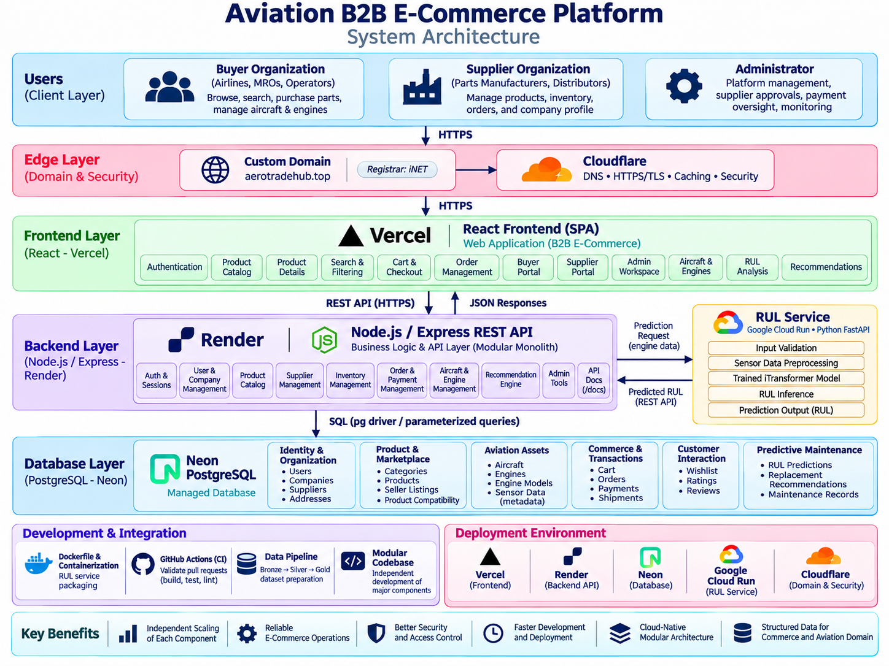

# AeroRUL — System Architecture

## 1. Overview

AeroRUL is an AI-enhanced B2B aviation engine and parts marketplace that connects airlines and Maintenance, Repair, and Overhaul (MRO) organizations with aviation parts suppliers.

The platform integrates B2B procurement (catalog, cart, multi-seller checkout, and simulated/bank-transfer payment workflows) with a Remaining Useful Life (RUL) simulation workflow and a **Replace & Buy** engine-listing recommendation MVP.

The system is organized around a **React 18 / Vite frontend (Vercel), a Node.js / Express 5 modular monolith (Render Web Service), a managed PostgreSQL database (Neon), and a containerized Python 3.11 / FastAPI inference service (Google Cloud Run)**. The architecture separates user interfaces, transactional business logic, persistent data, and deep-learning inference while keeping Express as the single API gateway for application operations.

**Production Status:** Verified and live at `https://www.aerotradehub.top` (owner end-to-end acceptance testing passed on November 16, 2026).

---

## 2. Master System Architecture

The editable diagram source is maintained in one draw.io file:

[**Open System Design — draw.io**](./system-design.drawio)

> [!NOTE]
> All nine pages in [`system-design.drawio`](./system-design.drawio) and their exported PNG diagrams below are synchronized with the verified production architecture (iNET + Cloudflare DNS Only, Vercel same-origin rewrites, Render Express monolith, Neon PostgreSQL, Google Cloud Run, HttpOnly cookie auth, `BANK_TRANSFER`, and implemented Replace & Buy recommendations).

Diagram exports in [./diagrams](./diagrams):

- [00 — Master System Architecture](<./diagrams/Final system-design-00 Master System Architecture.drawio.png>)
- [01 — Business & User Workflows](<./diagrams/Final system-design-01 Business & User Workflows.drawio.png>)
- [02 — Frontend Architecture](<./diagrams/Final system-design-02 Frontend Architecture.drawio.png>)
- [03 — REST API & Backend](<./diagrams/Final system-design-03 REST API & Backend.drawio.png>)
- [04 — PostgreSQL OLTP](<./diagrams/Final system-design-04 PostgreSQL OLTP (26 tables).drawio.png>)
- [05 — AI/RUL & Recommendation](<./diagrams/Final system-design-05 AI-RUL & Recommendation.drawio.png>)
- [06 — Deployment & Runtime](<./diagrams/Final system-design-06 Deployment & Runtime.drawio.png>)
- [07 — End-to-End Integration](<./diagrams/Final system-design-07 End-to-End Integration.drawio.png>)
- [08 — Physical Infrastructure & Scalability](<./diagrams/Final system-design-08 Physical Infrastructure & Scalability.drawio.png>)

### Final System Architecture Overview

*High-level production system overview diagram ([`./legacy/final_system_architecture.png`](./legacy/final_system_architecture.png)):*



This overview summarizes the deployed end-to-end architecture across all runtime and delivery layers:

- **Users (Client Layer):** Connects **Buyer Organizations** (Airlines, MROs, Operators), **Supplier Organizations** (Parts Manufacturers, Distributors), and **Administrators** (platform oversight, supplier approvals, payment reconciliation, RUL service health) over **HTTPS**.
- **Edge Layer (`aerotradehub.top` / iNET + Cloudflare):** Custom domain registered at **iNET** (`aerotradehub.top`) using **Cloudflare** for authoritative DNS and domain security controls before routing traffic to **Vercel**. *(Note: While the overview graphic groups DNS/TLS/caching/security under Cloudflare conceptually, verified production keeps Cloudflare in **DNS Only** mode with HTTP proxy/caching disabled so **Vercel Edge** terminates TLS directly.)*
- **Frontend Layer (React SPA on Vercel):** Delivers the 12 core UI functional capabilities—Authentication, Product Catalog, Product Details, Search & Filtering, Cart & Checkout, Order Management, Buyer Portal, Supplier Portal, Admin Workspace, Aircraft & Engines, RUL Analysis, and Recommendations—communicating via same-origin **REST API (HTTPS)** and receiving **JSON Responses**.
- **Backend Layer (Node.js / Express Modular Monolith on Render):** Consolidates Auth & Sessions, User & Company Management, Product Catalog, Supplier Management, Inventory Management, Order & Payment Management, Aircraft & Engine Management, Recommendation Engine, Admin Tools, and built API Docs (`/docs/`).
- **AI RUL Service (Python FastAPI on Google Cloud Run):** Invoked by Express (`Prediction Request` $\leftrightarrow$ `Predicted RUL` over HTTPS) to run Input Validation, Sensor Data Preprocessing, Trained iTransformer Model inference, and RUL prediction output.
- **Database Layer (Neon Managed PostgreSQL):** Accessed exclusively from Express via parameterized `pg` queries across six logical data groups: Identity & Organization (`Users`, `Companies`, `Suppliers`, `Addresses`), Product & Marketplace (`Categories`, `Products`, `Seller Listings`, `Product Compatibility`), Aviation Assets (`Aircraft`, `Engines`, `Engine Models`, `Sensor Data (metadata)`), Commerce & Transactions (`Cart`, `Orders`, `Payments`, `Shipments`), Customer Interaction (`Wishlist`, `Ratings`, `Reviews`), and Predictive Maintenance (`RUL Predictions`, `Replacement Recommendations`, plus conceptual maintenance tracking). *(Note: Legacy schema compatibility tables such as `account_tokens` and `notifications`/`ml_model_versions` are detailed in Diagram 04 above.)*
- **Development, Integration & Deployment Environment:** Highlights Dockerized RUL packaging (`rul-service/Dockerfile`), GitHub Actions CI checks, Bronze $\to$ Silver $\to$ Gold dataset preparation, modular codebase separation, and the five cloud infrastructure pillars (**Vercel**, **Render**, **Neon**, **Google Cloud Run**, **Cloudflare**).

---

## 3. Core Business Flows

AeroRUL supports two procurement paths that converge into the same cart and checkout process.

### Path A — Standard B2B Procurement

**Buyer $\to$ Marketplace $\to$ Product & Approved Supplier Listings $\to$ Shared Cart $\to$ Checkout (`SIMULATION` or `BANK_TRANSFER`) $\to$ Order Fulfillment**

Buyers browse aviation parts, compare active offers from approved suppliers, and place multi-supplier orders through a single transactional checkout.

### Path B — Buyer RUL Analysis & Replace & Buy Procurement

**Buyer $\to$ Company Engine $\to$ FD002-Compatible Sensor CSV $\to$ RUL Inference (Cloud Run) $\to$ Saved Prediction History $\to$ Replace & Buy Recommendations $\to$ Shared Cart $\to$ Checkout**

Buyers select a company-owned engine and submit a compatible 19-column sensor CSV along with a declared source classification (`X-RUL-Source`). Express sends the CSV to the FastAPI model on Google Cloud Run, saves the prediction in PostgreSQL, derives a project demo urgency label (`NORMAL`, `MONITOR`, `PREPARE`, `PRIORITIZE`), and can generate up to five ranked replacement `ENGINE` listings based on exact `product_engine_compatibility` evidence, approved Supplier status, and positive stock. Selected listings enter the shared Buyer cart and follow the standard Path A checkout transaction.

---

## 4. Architecture Components

### Frontend — React 18 / Vite 5 (Vercel)

The frontend provides role-based workspaces for Public visitors, Buyers, Suppliers, and Administrators:
- **Public:** Catalog browsing, product detail, supplier offer comparison, Login, and Register (no email verification step in MVP).
- **Buyer:** Dashboard, engine inventory CRUD, RUL CSV analysis & history, Replace & Buy recommendations, cart, checkout (`SIMULATION` and `BANK_TRANSFER`), and order tracking.
- **Supplier:** Store overview, listings CRUD, inventory management, and seller-order fulfillment (`CONFIRMED` $\to$ `PROCESSING` $\to$ `SHIPPED` $\to$ `DELIVERED`, gated on `SUCCEEDED` payment).
- **Admin:** Marketplace dashboard, Supplier approval (`PENDING` $\to$ `APPROVED`), Bank Transfer payment reconciliation (`confirm` / `cancel`), and RUL service health monitoring.

The React application communicates strictly with same-origin `/api/v1/*` endpoints (via Vite dev proxy locally or Vercel rewrites in production) using `credentials: "include"` and `X-AeroRUL-Request: 1` on state-changing requests. It never connects directly to PostgreSQL or Google Cloud Run.

### Backend — Node.js / Express 5 (Render Web Service)

The backend follows a **modular monolith** architecture using an MVC-inspired layered structure (Routes $\to$ Middleware $\to$ Controllers $\to$ Services $\to$ SQL Repositories via `pg.Pool`). All business modules operate within one Express application rather than separate microservices.

Key responsibilities:
- Cookie-based HS256 JWT authentication (1-hour TTL, `HttpOnly; SameSite=Lax`, `Secure` in production), Argon2id password verification, server-side role/company ownership enforcement, and CSRF header + `Origin` (`PUBLIC_WEB_URL`) validation.
- Catalog discovery, Supplier listing/inventory/order operations, and Admin supplier/payment/RUL-health endpoints.
- Transactional cart/checkout (`SIMULATION` immediate success; `BANK_TRANSFER` pending with Admin confirmation/cancellation stock restoration).
- RUL orchestration, private CSV persistence, `replacement_recommendations` ranking, and serving generated apiDoc at `/docs/`.

### Database — Managed PostgreSQL (Neon)

PostgreSQL provides persistent OLTP storage across all application domains:
- **Baseline Schema ([`database/schema/01_schema.sql`](../../database/schema/01_schema.sql)):** **26 tables** covering identity/organizations, fleet, catalog/stock, shopping, orders/payments/fulfillment, AI/RUL, and engagement.
- **Additive Auth Extension ([`database/authentication/01_authentication_setup.sql`](../../database/authentication/01_authentication_setup.sql)):** Adds `account_tokens` (making **27 tables** total) and `users.email_verified_at` / `users.auth_version`, retained for historical schema compatibility and unused by the active no-email MVP runtime.
- **Payment MVP Migration ([`database/migrations/04_b2b_payment_mvp.sql`](../../database/migrations/04_b2b_payment_mvp.sql)):** Enforces `SIMULATION` and `BANK_TRANSFER` payment state constraints.

Express accesses Neon PostgreSQL over TLS (`PGSSLMODE=require`) using parameterized SQL queries and `pg.Pool`.

### AI Inference — FastAPI Container (Google Cloud Run)

The RUL request path is:

```text
React Buyer UI -> Vercel (/api/v1/rul/...) -> Render Express API -> Google Cloud Run FastAPI -> Condition-Aware iTransformer v3
```

Express enforces Buyer session authorization, engine-company ownership, `Idempotency-Key`, and `X-RUL-Source` provenance labeling before posting the raw `text/csv` payload over **HTTPS** to Google Cloud Run with `X-RUL-Service-Token`. FastAPI (`rul-service/api.py`) loads the frozen FD002 checkpoint (`checkpoints/best_model.weights.h5`) and scaler (`preprocessing/scaler_artifacts.json`) at container startup, validates the 19 required columns and $\ge 30$ observations, and returns the predicted RUL cycles. FastAPI has no database connection and no end-user authentication responsibility.

### Replacement Recommendations & Academic Scope Limits

The Replace & Buy MVP recommends up to five `ENGINE` listings after a successful Buyer RUL prediction using exact `engine_model_id` compatibility evidence, an active product, an `ACTIVE` listing, an `APPROVED` supplier, and positive stock, ranked deterministically by lower actual listing price, shorter lead time, then listing ID.

**Scope Limits:**
- Predictions and 20/40/80-cycle urgency rules are academic simulation support features, **not** certified FAA/EASA airworthiness guidance or verified real-aircraft telemetry.
- Compatibility evidence is demo-constrained and does not certify aircraft installation approval.
- Trade-in, buyback, old-engine collection, fair-market valuation, and exchange credit remain **out of scope**.

### Data Engineering (Offline Preparation)

An offline Python ETL pipeline prepares initial catalog and demonstration data:

**Bronze $\to$ Silver $\to$ Gold $\to$ PostgreSQL Seed Initialization (`database/seed/load_gold.py`)**

This pipeline does not run during marketplace runtime requests. Detailed documentation is in [Data Engineering](../data/README.md).

---

## 5. Architecture Diagrams Summary

| Page | Diagram | Focus | Alignment Status |
|---|---|---|---|
| 00 | [Master System Architecture](<./diagrams/Final system-design-00 Master System Architecture.drawio.png>) | System boundaries and core flows | Synchronized |
| 01 | [Business & User Workflows](<./diagrams/Final system-design-01 Business & User Workflows.drawio.png>) | Buyer, supplier, admin, and AI workflows | Synchronized |
| 02 | [Frontend Architecture](<./diagrams/Final system-design-02 Frontend Architecture.drawio.png>) | React workspaces, cookie auth, and API client | Synchronized |
| 03 | [REST API & Backend](<./diagrams/Final system-design-03 REST API & Backend.drawio.png>) | Middleware, backend modules, and endpoints | Synchronized |
| 04 | [PostgreSQL OLTP](<./diagrams/Final system-design-04 PostgreSQL OLTP (26 tables).drawio.png>) | 26 core + 1 legacy auth table (`account_tokens`), domains & FKs | Synchronized |
| 05 | [AI/RUL & Recommendation](<./diagrams/Final system-design-05 AI-RUL & Recommendation.drawio.png>) | Inference and Replace & Buy pipeline | Synchronized |
| 06 | [Deployment & Runtime](<./diagrams/Final system-design-06 Deployment & Runtime.drawio.png>) | Hosting and runtime boundaries | Synchronized |
| 07 | [End-to-End Integration](<./diagrams/Final system-design-07 End-to-End Integration.drawio.png>) | Cross-component request sequences & traceability | Synchronized |
| 08 | [Physical Infrastructure & Scalability](<./diagrams/Final system-design-08 Physical Infrastructure & Scalability.drawio.png>) | AS-IS deployed topology & TO-BE horizontal scaling architecture | Synchronized |

---

## 6. Verified Production Deployment Topology

| Component | Technology / Hosting | Role |
|---|---|---|
| **Domain Registrar** | `aerotradehub.top` — **iNET** | Domain registration and Cloudflare nameserver delegation |
| **Authoritative DNS** | **Cloudflare Free (DNS Only)** | DNS resolution (HTTP proxy disabled; Vercel handles TLS) |
| **Frontend & API Proxy** | React 18 / Vite — **Vercel** (`https://www.aerotradehub.top`) | Static SPA, apex HTTP 308 $\to$ `www`, same-origin `/api/*` and `/docs/*` rewrites |
| **Application Backend** | Node.js / Express 5 — **Render Web Service** | Modular monolith API + generated apiDoc at `/docs/` |
| **Database** | Managed PostgreSQL — **Neon** | Persistent OLTP relational database over TLS |
| **AI Inference** | Python 3.11 / FastAPI / TensorFlow — **Google Cloud Run** | Containerized inference (`rul-service/Dockerfile`), HTTPS + `X-RUL-Service-Token` |
| **RUL CSV Storage** | Private Render filesystem (`backend/storage/rul/`) | Ephemeral across restarts/redeploys; external object storage not provisioned |

For operational runbooks, environment variable tables, and cold-start/recovery details, see [Deployment Architecture & Runbook](../devops/deployment/README.md).

---

## 7. Related Documentation

- [Documentation Home](../README.md)
- [REST API](../api/README.md)
- [Database Design](../database/README.md)
- [Data Engineering](../data/README.md)
- [RUL System Design](../rul/architecture/SYSTEM_DESIGN.md)
- [UI/UX Design](../ui-ux/README.md)
- [DevOps & Deployment](../devops/README.md)
