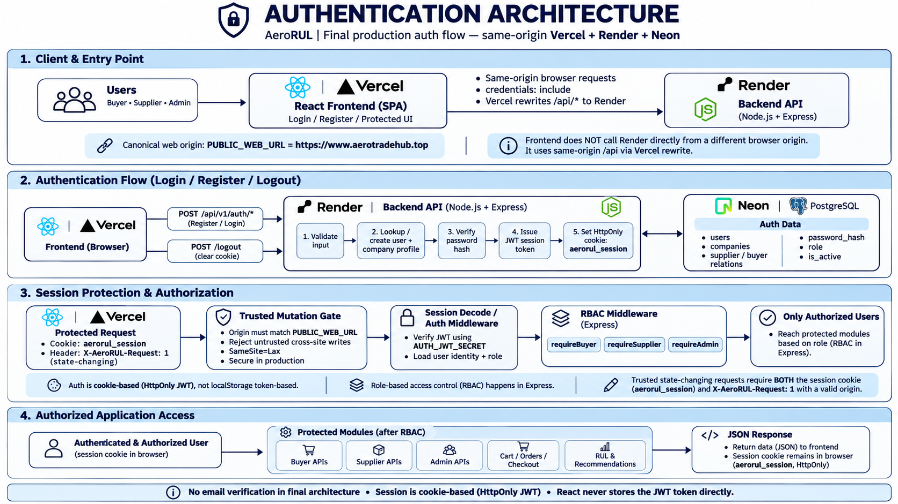

# AeroRUL Authentication

Cookie-based JWT authentication, Argon2id password security, CSRF protection, and Express RBAC across **Vercel (SPA)** $\to$ **Render (Express 5)** $\to$ **Neon (PostgreSQL)**.



## 1. Architecture Flow Breakdown

| Stage | Component & Transport | Implemented Behavior |
|---|---|---|
| **1. Client & Entry Point** | Users (`Buyer`, `Supplier`, `Admin`) $\to$ **React SPA (Vercel)** $\to$ **Express API (Render)** | Browser calls same-origin `/api/*` (`credentials: "include"`). Vercel rewrites `/api/*` to Render so cookies stay same-origin against `PUBLIC_WEB_URL` (`https://www.aerotradehub.top`). |
| **2. Authentication Flow** | `POST /api/v1/auth/register` · `POST /api/v1/auth/login` · `POST /api/v1/auth/logout` | **5-step Express pipeline:** (1) validate input, (2) lookup/create `users` + `companies` (+ `PENDING` `suppliers`), (3) hash/verify `password_hash` with **Argon2id**, (4) sign 1h HS256 JWT (`{ sub }`), (5) set/clear `HttpOnly` cookie `aerorul_session` synced with Neon (`users`, `companies`, `suppliers`, `role`, `is_active`). |
| **3. Session Protection & RBAC** | `requireTrustedMutation` $\to$ `requireAuth` $\to$ `requireBuyer` / `requireSupplier` / `requireAdmin` | Validates `aerorul_session` via `AUTH_JWT_SECRET`, reloads current `users.is_active` & `role` from Neon, checks role/approval (`APPROVED` supplier via `company_id`), and enforces CSRF header + `Origin` on writes. |
| **4. Authorized Access** | Protected Express Modules $\to$ JSON Response | Authorized requests reach Buyer, Supplier, Admin, Cart/Checkout, and RUL/Recommendation routes; Express returns JSON while `aerorul_session` remains browser-managed (`HttpOnly`, never in `localStorage`). |

> [!NOTE]
> **No-Email Academic MVP:** Registration activates users immediately without email delivery or `email_verified_at` checks; Suppliers remain `PENDING` until an `ADMIN` approves them. Historical verification schema artifacts (`account_tokens`, `users.email_verified_at`, `users.auth_version`) remain unused at runtime.

---

## 2. Authentication Endpoints (`/api/v1/auth`)

| Method | Endpoint | Middleware & Rate Limit | Request / Notes | Success & Key Errors |
|---|---|---|---|---|
| `POST` | `/api/v1/auth/register` | `rateLimit` (5 req / 15 min) | `account_type` (`BUYER`\|`SUPPLIER`), `full_name`, `email`, `password` (12–128 chars), `company_name`, `country_code`, `[company_type]`, `[store_name]` | `201 Created` (`user_id`, `company_id`, `[supplier_id]`, `role`) · `400 INVALID_INPUT` · `409 ACCOUNT_CONFLICT` · `429 RATE_LIMITED` |
| `POST` | `/api/v1/auth/login` | `rateLimit` (5 req / 15 min) + `requireTrustedMutation` | JSON `{ email, password }` + header `X-AeroRUL-Request: 1` | `200 OK` (`data.user` only; no JWT in JSON) + sets `aerorul_session` · `401 INVALID_CREDENTIALS` · `403 ACCOUNT_DISABLED` / `UNTRUSTED_*` |
| `GET` | `/api/v1/auth/me` | `requireAuth` | Cookie `aerorul_session` (`credentials: "include"`) | `200 OK` (`user_id`, `company_id`, `full_name`, `email`, `role`) · `401 AUTH_REQUIRED` |
| `POST` | `/api/v1/auth/logout` | `requireTrustedMutation` + `requireAuth` | Header `X-AeroRUL-Request: 1` + valid session cookie | `200 OK` (`{ logged_out: true }`) + clears cookie · `401 AUTH_REQUIRED` · `403 UNTRUSTED_*` |

---

## 3. Session, Cookie & CSRF Contract

- **Password Security:** Argon2id hashing (`argon2`); login queries `LOWER(email)` and rejects disabled accounts (`is_active = FALSE`).
- **JWT Cookie (`aerorul_session`):** `HS256`, `1h` expiry, `{ sub: user_id }` only, signed/verified with `AUTH_JWT_SECRET` ($\ge 32$ bytes). Flags: `HttpOnly`, `SameSite=Lax`, `Path=/`, `Secure` when `NODE_ENV=production`.
- **CSRF Mitigation (`requireTrustedMutation`):** Required on login, logout, and all non-`GET`/`HEAD`/`OPTIONS` protected routes:
  - Header `X-AeroRUL-Request: 1` mandatory.
  - `Origin` header (when present) must strictly match `PUBLIC_WEB_URL`.
  - Requests with `Sec-Fetch-Site: cross-site` are rejected (`403 UNTRUSTED_ORIGIN`).
- **Session Lifecycle:** Logout immediately clears the browser cookie (`path: "/"`). No refresh tokens or server-side revocation table are used; copied tokens expire after 1 hour.

```js
fetch("/api/v1/auth/login", {
  method: "POST",
  credentials: "include",
  headers: { "Content-Type": "application/json", "X-AeroRUL-Request": "1" },
  body: JSON.stringify({ email, password }),
});
```

---

## 4. Express RBAC Middleware

| Middleware | Protected Route Groups | Server-Side Checks | Failure Codes |
|---|---|---|---|
| `requireAuth` | `/api/v1/auth/me`, `/logout` | Verifies `aerorul_session` JWT + reloads active user from `public.users` | `401 AUTH_REQUIRED`, `503 AUTH_UNAVAILABLE` |
| `requireBuyer` | `/cart`, `/checkout`, `/orders`, `/dashboard`, `/engines`, `/rul` | `requireAuth` $\to$ `role === "BUYER"` $\to$ `requireTrustedMutation` | `403 BUYER_REQUIRED`, `403 UNTRUSTED_*` |
| `requireSupplier` | `/api/v1/supplier/*` (`overview`, `listings`, `inventory`, `orders`) | `requireAuth` $\to$ `role === "SUPPLIER"` $\to$ `suppliers.status = 'APPROVED'` (derives `req.supplierId`) $\to$ `requireTrustedMutation` | `403 FORBIDDEN`, `403 SUPPLIER_NOT_APPROVED` |
| `requireAdmin` | `/api/v1/admin/*` (`dashboard`, `suppliers`, `payments`, `rul`) | `requireAuth` $\to$ `role === "ADMIN"` $\to$ `requireTrustedMutation` | `403 ADMIN_REQUIRED`, `403 UNTRUSTED_*` |

---

## 5. Setup, Environment & Source Layout

### Backend Dependencies (`cd backend && npm ci`)

| Package | Role | Package | Role |
|---|---|---|---|
| `express`, `pg` | REST routing & Neon PostgreSQL pool/TX | `express-rate-limit` | 5 req / 15 min throttle on register & login |
| `argon2` | Argon2id password hashing & verification | `dotenv` | Local `.env` loading |
| `jsonwebtoken`, `cookie-parser` | 1h HS256 JWT + `HttpOnly` cookie parsing | `apidoc`, `nodemon` (dev) | `/docs/` API build (`npm run doc`) & dev reload |

### Required Environment Variables (Names Only — Private Values in `.env` / Render)

- **Database (`pg.Pool`):** `DB_HOST`, `DB_PORT`, `DB_NAME`, `DB_USER`, `DB_PASSWORD` (+ `PGSSLMODE=require` on Neon). Needs `SELECT` on `users`, `suppliers` and `INSERT` on `companies`, `users`, `suppliers`.
- **Auth & Origin:** `AUTH_JWT_SECRET` ($\ge 32$ random chars), `PUBLIC_WEB_URL` (`http://localhost:5173` local / `https://www.aerotradehub.top` prod), `NODE_ENV` (`development` / `production`).
- **Frontend Auth Integration:** See [Frontend Authentication Guide](./FRONTEND_GUIDE.md) and [Frontend README](../../frontend/README.md) (`VITE_SUPPLIER_DEMO_MODE=false` in prod).

### Backend Source Files

```text
backend/src/
  routes/auth/index.js                    # POST /register, POST /login, GET /me, POST /logout
  controllers/auth/register.controller.js # Registration transaction & conflict mapping
  controllers/auth/session.controller.js  # Login, /me, logout HTTP handlers
  services/auth/register.service.js       # Atomic companies + users + suppliers insert
  services/auth/register.validation.js    # Field rules (blocks ADMIN role & client IDs)
  services/auth/session.service.js        # Argon2id check, JWT issue/verify, publicUser()
  middleware/require-auth.js              # Cookie JWT verification + live user lookup
  middleware/require-trusted-mutation.js  # X-AeroRUL-Request + PUBLIC_WEB_URL Origin CSRF gate
  middleware/require-buyer.js             # BUYER guard + CSRF
  middleware/require-supplier.js          # SUPPLIER + APPROVED company check + CSRF
  middleware/require-admin.js             # ADMIN guard + CSRF
```

---

## 6. Verification & Scope Boundaries

- **Offline Checks (`backend/`):** `node --check`, `node --test tests/auth-*.test.cjs`, `npm run doc`, and `git diff --check`.
- **Production Acceptance:** Verified end-to-end on Vercel + Render + Neon at `https://www.aerotradehub.top` on **November 16, 2026** (Registration, Login, `/me`, Role/Approval Guards, Logout). Automated browser E2E suites (Playwright/Cypress) and email/password-reset flows are out of scope.
- **Related Design Details:** [AUTHENTICATION_DESIGN.md](./AUTHENTICATION_DESIGN.md) · [FRONTEND_GUIDE.md](./FRONTEND_GUIDE.md)
