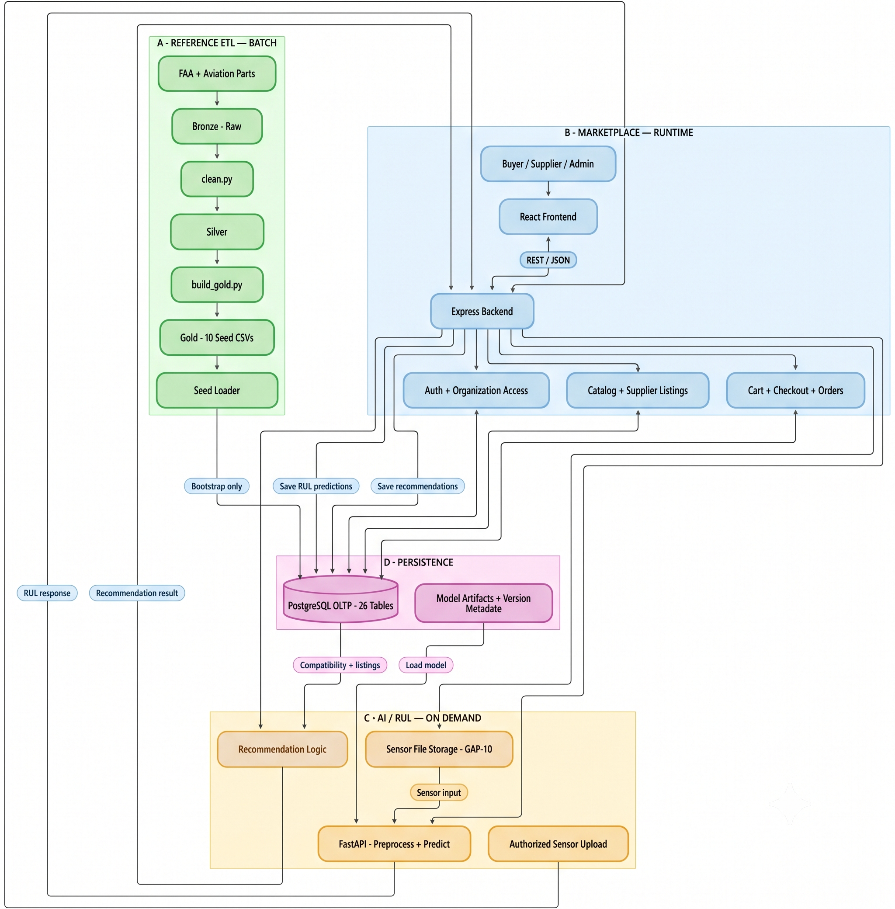

# Architecture Overview

The Overall Data Architecture illustrates how reference datasets, marketplace transactions, and AI-driven Remaining Useful Life (RUL) predictions are processed and managed within the B2B Aviation Engine & Parts Marketplace.

The architecture consists of four interconnected domains: **Reference ETL (A)**, **Marketplace Runtime (B)**, **AI/RUL Processing (C)**, and **Data Persistence (D)**. Each domain has a distinct responsibility while sharing PostgreSQL as the application's operational database.

**Project:** B2B Aviation Engine & Parts Marketplace with RUL-Based Recommendations

## How to Read the Architecture Diagram

### A — Reference ETL: Data Preparation and Initial Seeding

The Reference ETL pipeline prepares external aviation data for use in the marketplace.

Selected FAA aircraft and engine records, together with aviation parts reference data, are first preserved in the **Bronze layer**. The `clean.py` script processes these sources by validating records, removing duplicates, standardizing values, and resolving reference relationships.

The resulting **Silver layer** contains four cleaned datasets:

- Engine model references
- Aircraft references
- Aviation parts
- Supplier references derived from valid parts

The `build_gold.py` script transforms these datasets into ten relational CSV files aligned with the application's database schema. This stage combines cleaned source references with explicitly generated demonstration data, including marketplace organizations, aircraft assignments, product identities, commercial listings, and engine compatibility relationships.

Before export, Gold data is validated against schema constraints, foreign-key relationships, and application-specific business rules.

The validated Gold datasets are subsequently loaded into PostgreSQL to initialize the marketplace's reference catalog and demonstration entities. This is a **controlled bootstrap process**, not a continuous synchronization pipeline. Once the application begins operating, subsequent data imports must preserve records created or modified through marketplace transactions.

### B — Marketplace Runtime: Transactional Business Operations

The Marketplace Runtime domain manages interactions between **Buyers, Suppliers, Administrators**, and the application.

Users interact with the **React frontend**, which communicates with the **Node.js/Express backend** through REST APIs using JSON request and response payloads. The frontend does not access PostgreSQL directly.

Express acts as the central application layer and organizes business functionality into three logical areas:

**Authentication and Organization Access**

Handles user authentication, role-based permissions, organization membership, and access to organization-owned resources. Authorization rules ensure that users can access or modify only the business records they are permitted to manage.

**Catalog and Supplier Listings**

Provides product discovery, category browsing, product information, supplier offers, pricing, stock availability, and engine compatibility information. Authorized suppliers manage their own commercial listings through the application.

**Cart, Checkout, and Orders**

Manages shopping carts, order creation, seller-specific order records, and subsequent commerce operations. Database transactions and business validation help maintain consistency between related records during checkout and order processing.

These functions are logical modules within a single Express backend rather than independent microservices.

Express reads and writes operational data through PostgreSQL. Product information, inventory, users, orders, payments, shipments, and other marketplace records are managed through this application-controlled data access layer.

### C — AI/RUL: Sensor Processing and Replacement Recommendations

The AI/RUL domain supports predictive maintenance by estimating the **Remaining Useful Life (RUL)** of aircraft engines and connecting prediction results to relevant marketplace products.

The process begins when an authorized user submits engine sensor data through the application. Express validates the request, verifies access to the relevant engine, and coordinates the sensor-data processing workflow.

Sensor files are handled through a dedicated file-storage mechanism, while associated upload information and processing records are managed by the application. The storage mechanism is logically separate from the PostgreSQL relational database.

The **Python/FastAPI RUL service** performs the computational inference workflow:

1. Receive and validate the expected sensor input.
2. Apply the preprocessing required by the selected RUL model.
3. Load the appropriate trained model artifacts.
4. Generate an RUL prediction.
5. Return the prediction response to Express.

Model artifacts support inference, while model-version metadata provides traceability between predictions and the models used to generate them.

Express coordinates the persistence of prediction results in PostgreSQL. The application then combines RUL information with engine-model compatibility, product references, active supplier listings, and available inventory to generate replacement recommendations.

Recommendations are stored as application records and returned through Express to the React frontend.

The RUL service is responsible for model inference; it does not independently modify marketplace inventory, product prices, or commercial transactions.

**RUL predictions and replacement recommendations are decision-support features.** They do not independently establish certified maintenance requirements or verified airworthiness eligibility.

### D — Persistence: Operational Data and Model Assets

The Persistence domain provides the storage foundation for reference data, marketplace operations, and AI-assisted workflows.

**PostgreSQL — Operational Relational Database**

PostgreSQL is the primary operational source of truth for the application. Its schema contains **26 relational tables** supporting company and user management, aviation assets, product catalogs, supplier listings, commerce transactions, and RUL-related records.

The database receives initial reference and demonstration data through the ETL bootstrap process. During normal operation, Express manages database reads and writes according to application business rules and authorization policies.

PostgreSQL is used as an **Online Transaction Processing (OLTP)** database, not as a data warehouse.

**Model Artifacts and Version Metadata**

Trained RUL model artifacts are maintained separately from marketplace transactional records. The inference service loads these artifacts to generate predictions, while model-version information is associated with prediction records for reproducibility and traceability.

**Sensor File Storage**

Uploaded sensor files are managed through a separate storage mechanism appropriate for file-based inputs. PostgreSQL maintains the related application metadata and references needed to associate uploads with engines, processing requests, and prediction results.

## Cross-Domain Data Flow and Ownership

The four domains interact through clearly defined responsibilities.

| Data Flow | Responsible Component | Destination |
|---|---|---|
| External reference preparation | Python ETL scripts | Silver and Gold datasets |
| Initial application data bootstrap | Controlled database seed process | PostgreSQL |
| User and organization operations | Express authentication and business modules | PostgreSQL |
| Product and supplier listing management | Express catalog and listing modules | PostgreSQL |
| Cart, checkout, and order processing | Express commerce modules | PostgreSQL |
| Sensor upload and processing coordination | Express backend | Sensor storage and FastAPI |
| RUL inference | FastAPI inference service | Express backend |
| Prediction and recommendation persistence | Express RUL/recommendation modules | PostgreSQL |
| Product compatibility and inventory retrieval | Express backend | PostgreSQL queries |
| Application responses | Express REST API | React frontend |

The architecture follows three core data-management principles:

**Separation of data preparation and runtime operations.** Reference ETL prepares initial datasets, while marketplace services manage operational changes after database initialization.

**Centralized application-controlled persistence.** Express enforces authorization, validation, and transactional consistency before modifying application records.

**Separation of inference and commerce responsibilities.** FastAPI produces model predictions, while Express manages their business interpretation, persistence, and integration with marketplace functionality.

Together, these principles provide a coherent data architecture that supports the marketplace's transactional requirements while integrating aviation reference data and AI-driven predictive maintenance capabilities.
