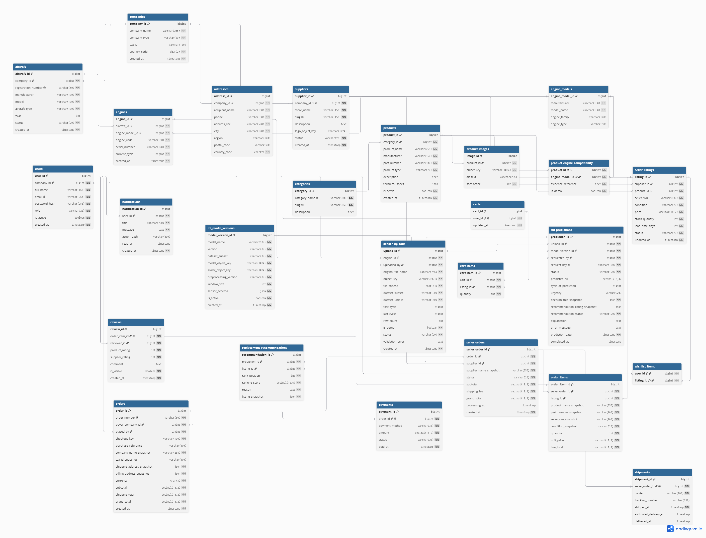
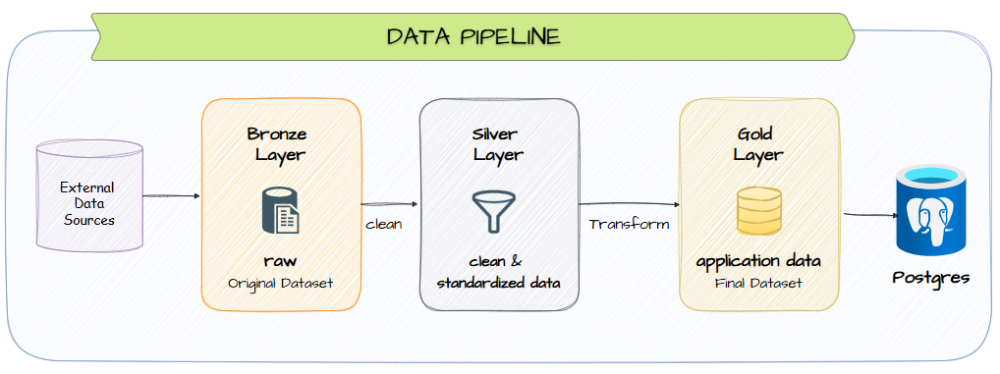
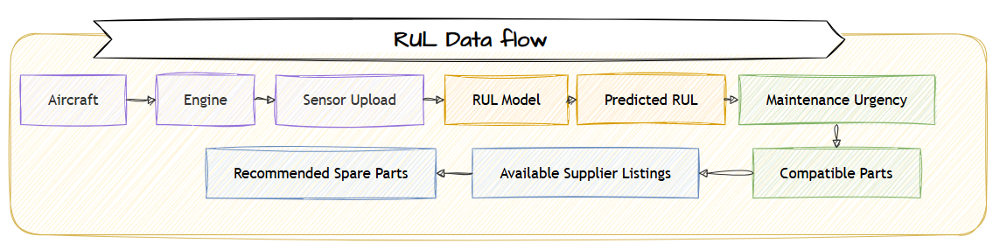
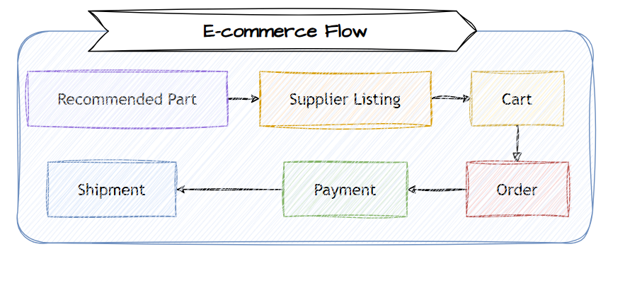

# Database & Data Pipeline

The Aviation B2B E-Commerce Platform combines aviation, engine-health,
supply-chain, and e-commerce data into a unified PostgreSQL database.

The database supports three connected domains:

**Aircraft & Engine → RUL Prediction → Spare-Part Recommendation → B2B Purchase**

## Architecture diagram references

The database design connects directly to the main architecture views:

- [00 — Master System Architecture](<../architecture/diagrams/System_Design_ver 1.0-00 Master System Architecture.drawio.svg>) — high-level data and application boundaries.
- [04 — PostgreSQL OLTP](<../architecture/diagrams/System_Design_ver 1.0-04 PostgreSQL OLTP (26 tables).drawio.svg>) — the canonical ERD and relational structure.
- [05 — AI/RUL & Recommendation](<../architecture/diagrams/System_Design_ver 1.0-05 AI-RUL & Recommendation.drawio.svg>) — how RUL output and recommendations relate to database records.
- [06 — Deployment & Runtime](<../architecture/diagrams/System_Design_ver 1.0-06 Deployment & Runtime.drawio.svg>) — operational deployment boundary for PostgreSQL and runtime services.

For the full architecture documentation, see [docs/architecture/README.md](../architecture/README.md).

## 1. Database Design

The system uses **PostgreSQL** as the primary operational database.

The database is organized around five main domains:

| Domain | Main Tables |
|---|---|
| Identity & Organization | `users`, `companies`, `addresses` |
| Aviation Assets | `aircraft`, `engines`, `engine_models` |
| Marketplace | `products`, `suppliers`, `seller_listings`, `product_engine_compatibility` |
| Commerce | `carts`, `orders`, `order_items`, `payments`, `shipments`, `reviews` |
| AI / RUL | `sensor_uploads`, `ml_model_versions`, `rul_predictions`, `replacement_recommendations` |

### ERD



- Schema definition: [`database-schema.dbml`](./database-schema.dbml)
- Interactive documentation: https://dbdocs.io/billbush0511/ERD-B2B-ecommerce-RUL-Website?view=relationships

---

## 2. Data Sources

The platform requires data from multiple domains because no single dataset
contains aircraft information, engine sensor data, spare parts, suppliers,
inventory, and e-commerce transactions together.

| Source | Usage |
|---|---|
| NASA C-MAPSS | Engine sensor data and RUL model development |
| FAA Aircraft / Engine Data | Aircraft and engine reference data |
| Aviation Spare Parts Dataset | Aviation spare-part information |
| Supply Chain Datasets | Supplier, inventory, lead-time and availability data |
| E-Commerce Datasets | Orders, payments, shipping and review structures |
| Application-Generated Data | Users, carts, predictions, recommendations and transactions |

---

## 3. Data Pipeline

The project uses a lightweight **Medallion-style data pipeline** to transform
heterogeneous source datasets into application-ready data.



### Bronze Layer — Raw Data

The Bronze layer stores the original downloaded datasets with minimal or no
modification.

Examples:

- C-MAPSS engine sensor files
- FAA aircraft and engine files
- aviation spare-parts dataset
- supply-chain datasets
- e-commerce datasets

The purpose of this layer is to preserve the original source data.

### Silver Layer — Cleaned & Standardized Data

The Silver layer transforms raw data into consistent records.

Typical processing includes:

- removing duplicates;
- handling missing values;
- standardizing column names and data types;
- normalizing identifiers;
- validating numeric and categorical values;
- mapping aircraft, engines, products and suppliers across sources.

Example:

```text
FAA ENGINE.txt
        +
Aircraft Reference Data
        ↓
Clean & Standardize
        ↓
engine_models.csv
```

### Gold Layer — Application-Ready Data

The Gold layer contains data structured according to the application's
PostgreSQL schema.

Examples:

```text
companies
addresses
categories
engine_models
suppliers
aircraft
engines
products
seller_listings
product_engine_compatibility
```

Gold data can then be loaded into PostgreSQL as seed/reference data using [`database/seed/load_gold.py`](../../database/seed/load_gold.py). For the complete table-by-table column specification and foreign-key load order, see [`GOLD_SEED_MAPPING.md`](./GOLD_SEED_MAPPING.md).

Unlike an analytical data warehouse, the Gold layer in this project represents
**application-ready operational data**, not analytical data marts.

---

## 4. RUL Data Flow

The RUL service connects aircraft condition monitoring with the marketplace.



The prediction is stored in `rul_predictions`.

The Replace & Buy recommendation MVP combines:

**Engine Model + Recorded Compatibility Evidence + Inventory + Supplier Listings**

to generate up to five ranked records in `replacement_recommendations` for a
successful company-owned prediction. Compatibility is an evidence-based
eligibility gate, not a score or installation certification. Trade-in,
buyback, and valuation remain deferred.

---

## 5. E-Commerce Flow

Once a suitable spare part is identified, the normal B2B purchasing workflow
takes place:



This creates the main end-to-end business flow of the platform:

> **Engine Condition → FD002 Demo Prediction → B2B Procurement**

The demo prediction does not verify compatibility and does not create
`replacement_recommendations`; standard marketplace procurement is a separate
existing flow.

---

## 6. Repository Structure

```text
database/
├── README.md
├── schema/
│   └── 01_schema.sql
├── migrations/
│   └── 04_b2b_payment_mvp.sql
├── authentication/
│   ├── 01_authentication_setup.sql
│   ├── 02_authentication_validation.sql
│   └── README.md
├── seed/
│   ├── 03_ml_model_version_seed.sql
│   └── load_gold.py
└── validation/
    └── 03_validation.sql

docs/database/
├── README.md
├── GOLD_SEED_MAPPING.md
├── database-schema.dbml
└── images/
```

The `bronze`, `silver`, and `gold` directories under `data/etl/` represent the transformation
stages used before application-ready data is loaded into PostgreSQL.


## Local data folders

See [data layer guide](../../data/etl/README.md) for the actual bronze/silver/gold layout and source mapping. Bronze preserves source files; silver contains cleaned references; gold contains schema-aligned custom demo seed data. Transformation folders are in `data/etl/scripts/bronze_to_silver` and `data/etl/scripts/silver_to_gold`.
