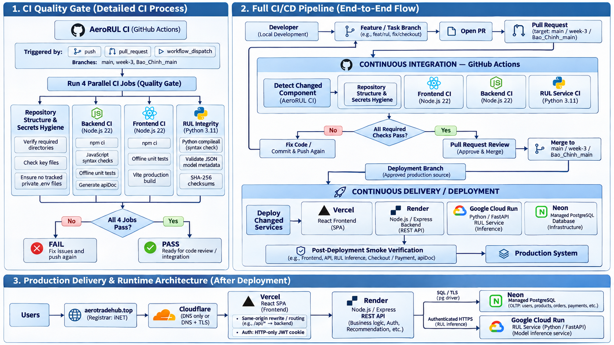

# CI/CD & Release Architecture

AeroRUL combines **GitHub Actions offline quality-gate CI** on integration branches with **platform-managed cloud delivery** across **iNET/Cloudflare**, **Vercel**, **Render**, **Neon**, and **Google Cloud Run**.

## 1. Pipeline Status Boundary

| Layer | Status | Scope & Mechanism |
|---|---|---|
| **Offline Quality Gate CI** | **Implemented** | [`.github/workflows/ci.yml`](../../../.github/workflows/ci.yml) runs on `push` & `pull_request` for `Bao_Chinh_main`, `week-3`, `main` (and `workflow_dispatch`) with `permissions: contents: read`. |
| **Cloud Production Hosting** | **Configured & Verified** | **Vercel** (React SPA + rewrites), **Render Web Service** (Express 5 on `deployment` branch), **Google Cloud Run** (FastAPI/TF Docker container), **Neon** (PostgreSQL). |
| **Smoke & E2E Acceptance** | **Verified (Manual)** | Owner-verified production testing at `https://www.aerotradehub.top` completed on **November 16, 2026**. |
| **Automated CD / Live DB Migrations** | **Out of Scope** | No GitHub Actions auto-deploy scripts, automated `psql` migrations, Terraform, or headless Playwright/Cypress CI runners. |

---

## 2. CI/CD Pipeline Diagram Breakdown

The diagram summarizes the full workflow across three views (also see editable system diagram [06 — Deployment & Runtime](<../../architecture/diagrams/System_Design_ver 1.0-06 Deployment & Runtime.drawio.svg>)):

1. **Panel 1 — CI Quality Gate (GitHub Actions):**
   Every `push`, `pull_request`, or `workflow_dispatch` targeting `main`, `week-3`, or `Bao_Chinh_main` triggers **4 parallel jobs** (`Repository Structure & Secrets Hygiene`, `Backend CI` on **Node.js 22**, `Frontend CI` on **Node.js 22**, and `RUL Integrity` on **Python 3.11**). All 4 must pass before integration/review (`PASS`); any failure blocks merge (`FAIL`).
2. **Panel 2 — Full CI/CD Pipeline (End-to-End Flow):**
   Developers work on feature branches, open a PR into `main` / `week-3` / `Bao_Chinh_main`, pass GitHub Actions CI, complete code review, and merge. Approved changes advance to the **`deployment`** branch, triggering **Vercel** and **Render** builds while **Google Cloud Run** (`rul-service/Dockerfile`) and **Neon** (`psql` / `load_gold.py`) are updated as needed, followed by post-deployment smoke verification.
   > [!NOTE]
   > **Implementation Detail:** Panel 2 depicts `Detect Changed Component` conceptually. In the current [`.github/workflows/ci.yml`](../../../.github/workflows/ci.yml), **all 4 CI jobs always run unconditionally** on every trigger (without path filtering), and Cloud Run builds / Neon migrations are operator-managed rather than dispatched by GitHub Actions.
3. **Panel 3 — Production Delivery & Runtime Architecture:**
   Requests flow from Users $\to$ `aerotradehub.top` (**iNET**) $\to$ **Cloudflare** $\to$ **Vercel** (React SPA, same-origin `/api/*` & `/docs/*` rewrites, `HttpOnly` JWT cookie auth) $\to$ **Render** (Express 5 REST API) $\to$ **Neon** (`SQL / TLS` via `pg`) and **Google Cloud Run** (authenticated `HTTPS` RUL inference).
   > [!NOTE]
   > **Production DNS Mode:** Panel 3 notes `DNS only or DNS + TLS` as options; AeroRUL production uses **Cloudflare DNS Only** (HTTP proxy disabled) while **Vercel Edge** terminates TLS.

---

## 3. GitHub Actions CI Quality Gate (`.github/workflows/ci.yml`)

- **Settings:** `permissions: contents: read` (offline only — no Neon, Cloud Run, or cloud deploy credentials), `concurrency.cancel-in-progress: true` per branch/PR, `actions/checkout@v7` (`persist-credentials: false`).

| Job (Timeout) | Runtime | Automated Checks |
|---|---|---|
| **Repository structure** (5 min) | `ubuntu-latest` | Verifies required folders (`frontend`, `backend`, `rul-service`, `data`, `database`, `docs`), lockfiles, schema/migration SQL (`01_schema.sql`, `04_b2b_payment_mvp.sql`), `rul-service/checksums.sha256`, and fails if any private `.env*` file (except `.env.example`) is tracked in Git. |
| **Backend CI** (15 min) | **Node.js 22** | `npm ci` $\to$ syntax check (`node --check` on `backend/src/**/*.js`) $\to$ offline unit tests (`node --test tests/*.test.cjs`, 93 mocked tests) $\to$ apiDoc build (`npm run doc`). |
| **Frontend CI** (15 min) | **Node.js 22** | `npm ci` $\to$ offline unit tests (`node --test tests/*.test.mjs`, 3 tests) $\to$ Vite production build (`npm run build`). |
| **RUL integrity** (10 min) | **Python 3.11** | `python -m compileall -q rul-service` $\to$ JSON validation for model/scaler/contract files $\to$ package SHA-256 verification (`sha256sum --check checksums.sha256`). |

*(Heavy TensorFlow CPU tests in `rul-service/tests/test_offline_inference.py` run offline outside PR CI; container builds verify model/scaler presence with `test -s` inside `rul-service/Dockerfile`.)*

---

## 4. Cloud Delivery & Deployment Branches

| Component | Target Platform | Delivery Trigger / Command | Notes |
|---|---|---|---|
| **Frontend SPA + Proxy** | **Vercel** (`https://www.aerotradehub.top`) | Git push to `deployment` (`frontend/`) | Builds Vite bundle; [`frontend/vercel.json`](../../../frontend/vercel.json) enforces `/docs` $\to$ `/docs/` redirect and `/api/*` + `/docs/*` rewrites. |
| **Express Backend + apiDoc** | **Render Web Service** (`aerorul-backend.onrender.com`) | Git push to `deployment` (`backend/`) | Build: `npm ci --include=dev && npm run build`; Start: `npm start` (installs `devDependencies` so `apidoc` builds `/docs/`). |
| **AI Inference Container** | **Google Cloud Run** (`asia-southeast1`) | Image built from [`rul-service/Dockerfile`](../../../rul-service/Dockerfile) | Bundles `best_model.weights.h5` & `scaler_artifacts.json`; runs `uvicorn api:app --host 0.0.0.0 --port ${PORT:-8080} --workers 1`. |
| **PostgreSQL OLTP** | **Neon Managed PostgreSQL** | Operator CLI (`psql` + `load_gold.py`) | Migrations/seeds applied manually over TLS (`DATABASE_URL`). |

Full provider settings and recovery steps are documented in [`docs/devops/deployment/README.md`](../deployment/README.md).

---

## 5. Post-Deployment Smoke Checks, Recovery & Secrets

### Smoke Verification Checklist
1. **Domain & Edge:** `https://www.aerotradehub.top` loads React SPA; `https://aerotradehub.top` returns `308` $\to$ `www`; `https://www.aerotradehub.top/docs/` loads apiDoc.
2. **Express $\leftrightarrow$ Neon:** Public catalog (`GET /api/v1/products`), Auth (`POST /api/v1/auth/login`, `GET /api/v1/auth/me`), Cart/Checkout (`SIMULATION` & `BANK_TRANSFER`), and Admin reconciliation succeed.
3. **Express $\leftrightarrow$ Cloud Run:** `GET /api/v1/admin/rul/health` returns `healthy` / `model_loaded: true`; Buyer `POST /api/v1/rul/engines/:engineId/predict` stores prediction rows in Neon.

### Failure Handling & Env Variable Names (Never Committed to Git)
- **CI Failure:** Blocks merge into `Bao_Chinh_main` / `week-3` / `main` until failing job logs are resolved and re-pushed.
- **Runtime / Deploy Failure:** Check Render, Vercel, or Cloud Run logs (cold starts, `PUBLIC_WEB_URL` CSRF origin match, or `RUL_SERVICE_TOKEN` mismatch) and roll back to the last healthy revision if needed.
- **Provider Env Names:**
  - **Render (`backend/`):** `NODE_ENV`, `PORT`, `DB_HOST`, `DB_PORT`, `DB_NAME`, `DB_USER`, `DB_PASSWORD`, `PGSSLMODE=require`, `AUTH_JWT_SECRET`, `PUBLIC_WEB_URL`, `RUL_SERVICE_URL`, `RUL_SERVICE_TOKEN`, `RUL_STORAGE_DIR` (optional).
  - **Cloud Run (`rul-service/`):** `RUL_SERVICE_TOKEN`, `PORT`, `TF_CPP_MIN_LOG_LEVEL=2`.
  - **Vercel (`frontend/`):** `VITE_SUPPLIER_DEMO_MODE=false`.
  - **Operator CLI:** `DATABASE_URL` (used only by `psql` and `database/seed/load_gold.py`).
