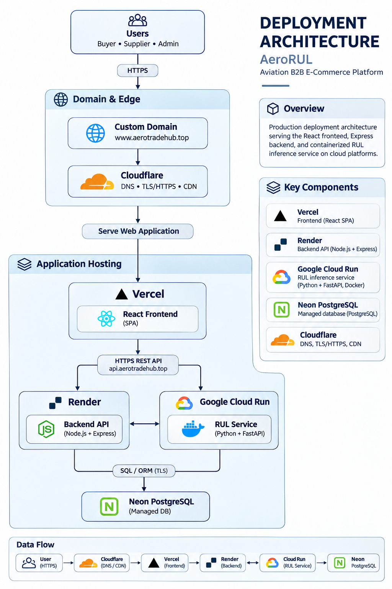

# AeroRUL Production Deployment Architecture & Runbook

- **Production URL:** `https://www.aerotradehub.top`
- **Status:** **DEPLOYED & VERIFIED** (Owner end-to-end acceptance testing passed on **November 16, 2026**)

---

## 1. Deployed Architecture Overview



> [!IMPORTANT]
> **Diagram vs. Verified Implementation Clarifications:**
> - **Same-Origin Rewrites (not `api.aerotradehub.top`):** The browser calls **`https://www.aerotradehub.top/api/*`** and `/docs/*`. Vercel rewrites those requests to Render (`aerorul-backend.onrender.com`); a separate `api.aerotradehub.top` subdomain is **not** deployed.
> - **Express-Only Gateway to Cloud Run & Neon:** Vercel/React never calls Google Cloud Run directly, and Google Cloud Run never connects to Neon PostgreSQL. **Render Express** is the sole client for both **Neon** (using parameterized `pg.Pool` SQL, **not** an ORM) and **Cloud Run** (HTTPS + `X-RUL-Service-Token`).
> - **Cloudflare DNS Only:** Registrar **iNET** delegates nameservers to Cloudflare Free in **DNS Only** mode (gray cloud, HTTP proxy/CDN disabled); **Vercel Edge** terminates TLS and serves the SPA.

| Layer | Implemented Technology | Provider | Verified Production Responsibility |
|---|---|---|---|
| **Registrar & DNS** | `aerotradehub.top` + Cloudflare Free (**DNS Only**) | **iNET** + **Cloudflare** | Domain registration, NS delegation, authoritative DNS without HTTP proxy |
| **Frontend & Edge Proxy** | React 18, Vite 5, Tailwind CSS, Router v6 | **Vercel** | Static SPA CDN, Vercel TLS, apex 308 $\to$ `www`, `/docs` $\to$ `/docs/` (307), `/api/*` & `/docs/*` rewrites |
| **Application Backend** | Node.js / Express 5 modular monolith | **Render Web Service** | REST `/api/v1/*`, Argon2id + 1h JWT cookie auth, CSRF checks, Neon transactions, static `/docs/` apiDoc |
| **Operational Database** | Managed serverless PostgreSQL (27 tables) | **Neon** | Persistent OLTP database accessed exclusively from Express over TLS (`PGSSLMODE=require`) |
| **AI Inference Service** | Python 3.11 / FastAPI / TensorFlow (FD002 iTransformer v3) | **Google Cloud Run** | Stateless Docker container (`rul-service/Dockerfile`, `asia-southeast1`), authenticated by `X-RUL-Service-Token` |

```text
Browser (https://www.aerotradehub.top)
  ├── 1. DNS lookup: iNET nameservers -> Cloudflare Free (DNS Only)
  ▼ 2. HTTPS (TLS terminated by Vercel; apex HTTP 308 -> www.aerotradehub.top)
Vercel Edge + Static SPA (/index.html fallback)
  ├── Redirect: /docs -> /docs/ (307)
  └── Same-Origin Rewrites: /api/*, /docs/*
  ▼
Render Web Service (https://aerorul-backend.onrender.com — branch: deployment)
  ├──► Neon PostgreSQL (TLS wire protocol, pg.Pool parameterized SQL)
  └──► Google Cloud Run FastAPI Container (HTTPS POST /v1/predict, GET /health + X-RUL-Service-Token)
```

---

## 2. Domain, DNS & Edge Routing (iNET, Cloudflare, Vercel)

1. **iNET (Registrar):** Holds `aerotradehub.top` and delegates nameservers to Cloudflare.
2. **Cloudflare Free (DNS Only):** Resolves `www` and apex records to Vercel with HTTP reverse proxy disabled (`DNS Only`).
3. **Vercel Routing ([`frontend/vercel.json`](../../../frontend/vercel.json)):**
   - Apex `https://aerotradehub.top` $\to$ HTTP `308` redirect to `https://www.aerotradehub.top`.
   - `/docs` $\to$ HTTP `307` (`permanent: false`) redirect to `/docs/`.
   - `/api/:path*` $\to$ `https://aerorul-backend.onrender.com/api/:path*`.
   - `/docs/` & `/docs/:path*` $\to$ `https://aerorul-backend.onrender.com/docs/`.
   - SPA Fallback: `/((?!api/|docs).*)` $\to$ `/index.html`.
   *(A standalone `docs.aerotradehub.top` subdomain is not deployed.)*

---

## 3. Vercel — React Frontend (`frontend/`)

- **Preset / Dir:** Vite · Root Directory `frontend` · Output `dist`
- **Commands:** Install `npm ci` · Build `npm run build`
- **Production Env Vars:** `VITE_SUPPLIER_DEMO_MODE=false` (disables mock fixtures so Supplier screens query `/api/v1/supplier/*`; `VITE_API_BASE_URL` is omitted so clients default to relative `/api`).

---

## 4. Render Web Service — Express Backend (`backend/`)

- **Service & Branch:** `Web Service` (Free plan) tracking **`deployment`** · Root Directory `backend` · Node.js 22
- **Build Command:** `npm ci --include=dev && npm run build` (`--include=dev` keeps `apidoc` when `NODE_ENV=production` to generate `backend/docs/apidoc/` for `/docs/`)
- **Start Command:** `npm start`

| Env Variable | Production Configuration / Role (Secret Values Stored in Render) |
|---|---|
| `NODE_ENV` | `production` (sets `Secure` on `aerorul_session` cookie; disables `/api/db-test`) |
| `PORT` | Injected automatically by Render (`3000` local fallback) |
| `DB_HOST`, `DB_PORT`, `DB_NAME`, `DB_USER`, `DB_PASSWORD` | Neon connection parameters read by `backend/src/config/db.js` (`DB_PORT=5432`) |
| `PGSSLMODE` | `require` (TLS connection from `pg.Pool` to Neon) |
| `AUTH_JWT_SECRET` | Random secret ($\ge 32$ bytes) for HS256 JWT cookies |
| `PUBLIC_WEB_URL` | `https://www.aerotradehub.top` (CSRF `Origin` validation & apiDoc base URL) |
| `RUL_SERVICE_URL` | Cloud Run HTTPS base URL (`https://<cloud-run-service>.run.app`) |
| `RUL_SERVICE_TOKEN` | Shared ASCII secret ($\ge 32$ chars, matching Cloud Run) sent as `X-RUL-Service-Token` |
| `RUL_STORAGE_DIR` | Optional override for private CSV directory (defaults to `backend/storage/rul`) |

- **Operational Boundaries:** No SMTP/email provider (no `SMTP_*` env vars; registration creates active accounts immediately). On Render Free, `backend/storage/rul/` is ephemeral across restarts/redeploys (no S3/GCS bucket or Persistent Disk provisioned); prediction records persist in Neon.

---

## 5. Neon PostgreSQL — Schema & Initialization

- **Credential Split:** Express uses `DB_HOST/PORT/NAME/USER/PASSWORD` + `PGSSLMODE=require`; offline CLI (`psql` and [`load_gold.py`](../../../database/seed/load_gold.py)) uses `DATABASE_URL` (`sslmode=require`).

```sh
# Fresh DB initialization sequence (run in order against $DATABASE_URL):
psql "$DATABASE_URL" -f database/schema/01_schema.sql                        # 26 baseline tables
psql "$DATABASE_URL" -f database/authentication/01_authentication_setup.sql # +account_tokens (27 tables total; legacy/unused at runtime)
psql "$DATABASE_URL" -f database/migrations/04_b2b_payment_mvp.sql          # SIMULATION & BANK_TRANSFER constraints
python database/seed/load_gold.py                                           # 10 Gold OLTP CSVs (data/etl/gold/)
psql "$DATABASE_URL" -f database/seed/03_ml_model_version_seed.sql          # Registers condition_aware_itransformer_v3
psql "$DATABASE_URL" -f database/validation/03_validation.sql               # Read-only baseline checks
psql "$DATABASE_URL" -f database/authentication/02_authentication_validation.sql
```

See [`database/README.md`](../../../database/README.md) for table and seed details.

---

## 6. Google Cloud Run — RUL Inference Container (`rul-service/`)

- **Packaging:** [`rul-service/Dockerfile`](../../../rul-service/Dockerfile) (`python:3.11-slim-bookworm`, excluded files in [`rul-service/.dockerignore`](../../../rul-service/.dockerignore)) bundles `checkpoints/best_model.weights.h5` and `preprocessing/scaler_artifacts.json` with `test -s` build-time checks.
- **Startup Command:** `exec uvicorn api:app --host 0.0.0.0 --port ${PORT:-8080} --workers 1`
- **Cloud Run Env Vars:** `RUL_SERVICE_TOKEN` ($\ge 32$ ASCII chars matching Render), `PORT` (Cloud Run injected; `8080` default), `TF_CPP_MIN_LOG_LEVEL=2` (in Dockerfile).
- **Security:** FastAPI disables OpenAPI UI endpoints (`docs_url=None`, `redoc_url=None`, `openapi_url=None`) and rejects missing/mismatched `X-RUL-Service-Token` headers (`401`).

---

## 7. Cold Starts, Verification & Recovery Runbook

### Cold Starts & Timeouts
- **Render Free Spin-Down:** ~15 min idle spin-down; cold wake typically takes ~20–50s to start Node and open Neon `pg.Pool`.
- **Cloud Run Scale-to-Zero:** Cold container startup loads TensorFlow + `RULInferenceEngine` (`lifespan` hook).
- **Express Timeouts:** `admin/rul-health.service.js` (`4,000 ms` on `GET /health` — may show `unavailable` during cold start until warmed up); `rul-inference.service.js` (`90,000 ms` on `POST /v1/predict`).

### Smoke Checks & Recovery Actions

| Check | Expected Result | If Failing / Recovery |
|---|---|---|
| Apex & SPA | `aerotradehub.top` `308` $\to$ `https://www.aerotradehub.top` | Verify Cloudflare DNS Only records point to Vercel. |
| Public API & Docs | `GET /api/v1/products` (`200` JSON); `/docs` `307` $\to$ `/docs/` | Confirm Render build (`npm ci --include=dev && npm run build`) & `frontend/vercel.json`. |
| Auth & CSRF | `/login` sets `aerorul_session`; writes succeed with `X-AeroRUL-Request: 1` | On `403 UNTRUSTED_ORIGIN`, confirm Render `PUBLIC_WEB_URL=https://www.aerotradehub.top` (no trailing slash). |
| RUL Health / Predict | `/admin/rul-health` `healthy` & `model_loaded: true` | Retry after 30–60s cold start; verify HTTPS `RUL_SERVICE_URL` & identical `RUL_SERVICE_TOKEN`. |
| DB / Rollback | Checkout, Payments, Orders read/write cleanly | Inspect Neon status + `DB_*`/`PGSSLMODE=require` on Render; roll back platform revision without dropping Neon data. |

---

## 8. Verification Status Matrix

| Component / Flow | Status | Evidence & Scope |
|---|---|---|
| **Offline Unit Tests & Checks** | **PASS** | Backend (`93/93`), Frontend (`3/3`), RUL offline inference (`7/7`), `git diff --check` (`0`). |
| **GitHub Actions CI (`ci.yml`)** | **IMPLEMENTED** | Offline quality gates on `Bao_Chinh_main`, `week-3`, `main` (`Node.js 22` + `Python 3.11`). |
| **Cloud Production Hosting** | **DEPLOYED & VERIFIED** | Vercel + Render (`deployment` branch) + Neon + Google Cloud Run + iNET/Cloudflare DNS Only. |
| **End-to-End Acceptance** | **PASS (Manual)** | Owner E2E testing passed **November 16, 2026** on `https://www.aerotradehub.top`. |
| **Email / SMTP & External Buckets** | **OUT OF SCOPE** | No email verification or SMTP; no S3/GCS bucket or Render Persistent Disk. |
| **Automated Live Browser E2E** | **NOT CONFIGURED** | No Playwright/Cypress runner in CI. |
