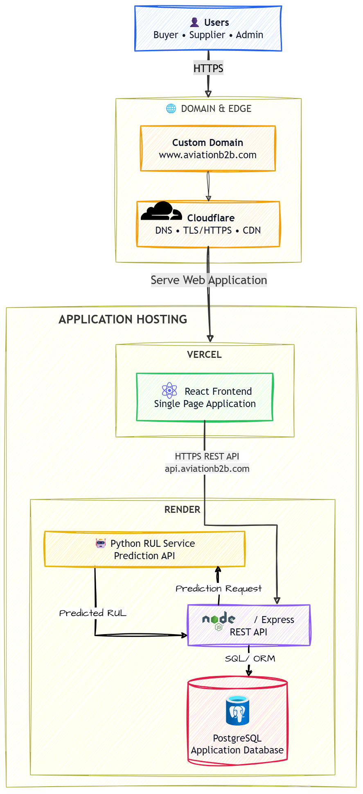

# Cloud Deployment Architecture

## Deployment Overview

The planned production platform uses a custom public domain managed by Cloudflare for DNS and HTTPS/TLS at the edge. Cloudflare directs users to the React frontend hosted on Vercel. The browser uses the platform's API domain to reach the Node.js/Express REST API hosted on Render. The Express backend is the application gateway to Render PostgreSQL and calls the internal FastAPI RUL service over HTTP.

## Deployment Architecture




## Production Request Flow

```text
User
	-> custom domain
	-> Cloudflare (DNS and edge HTTPS/TLS)
	-> Vercel React frontend
	-> REST API via API domain/subdomain
	-> Render Node.js/Express backend
	-> Render PostgreSQL
```

The frontend runs in the user's browser and sends business-data requests to the Express REST API. The backend reads or updates PostgreSQL as needed and returns API responses to the frontend. The browser never connects directly to PostgreSQL.

## RUL Prediction Flow

```text
React frontend
	-> Express backend on Render
	-> private FastAPI service over HTTP
	-> FD002-trained model and frozen scaler
	-> existing Render PostgreSQL connection for upload/prediction persistence
	-> API response to the frontend
```

The Express backend coordinates prediction requests and remains the only RUL
entry point for the frontend. It calls the configured `RUL_SERVICE_URL` and
authenticates with the shared `RUL_SERVICE_TOKEN`; no FastAPI route is exposed
to the browser or public API gateway. Deployments must place the Python service
on a private network, restrict inbound access to Express, use HTTPS for
remote service-to-service traffic, and provision the approved CPU dependencies
and frozen model/scaler assets with that service. The FastAPI process loads
the model and scaler once per worker at startup.

Set the same private `RUL_SERVICE_TOKEN` in both services and configure
`RUL_SERVICE_URL` only in Express. Express uses Node.js 18 or newer for its
built-in HTTP `fetch`; this calls the internal inference service and does not
alter the public Buyer API.

## Planned Domain Structure

The purchased project domain has not been specified in this document. The intended hostname pattern is:

| Hostname pattern | Destination |
|---|---|
| `<project-domain>` | React frontend on Vercel |
| `www.<project-domain>` | React frontend on Vercel |
| `api.<project-domain>` | Express REST API on Render |

Cloudflare manages DNS and HTTPS/TLS for the public domain and its hostnames. These are patterns only; no specific domain or production service URL is implied.

## Current Implementation Status

This README documents the planned deployment architecture. It does not claim that the domain, Cloudflare configuration, Vercel frontend, Render services, or database have already been provisioned or deployed. The current document does not record a verified live deployment status.

## Component Responsibilities

| Component | Planned hosting | Responsibility |
|---|---|---|
| Public domain and edge | Custom domain with Cloudflare | DNS and HTTPS/TLS at the domain/edge layer |
| Frontend | React SPA on Vercel | User interface and browser-side API requests |
| REST API | Node.js/Express on Render | Application gateway for business data and RUL requests |
| Database | Render PostgreSQL | Relational application data and prediction results when persistence is required |
| RUL inference | Private Python / FastAPI service | CPU inference over internal HTTP; runtime and model assets provisioned with the service |