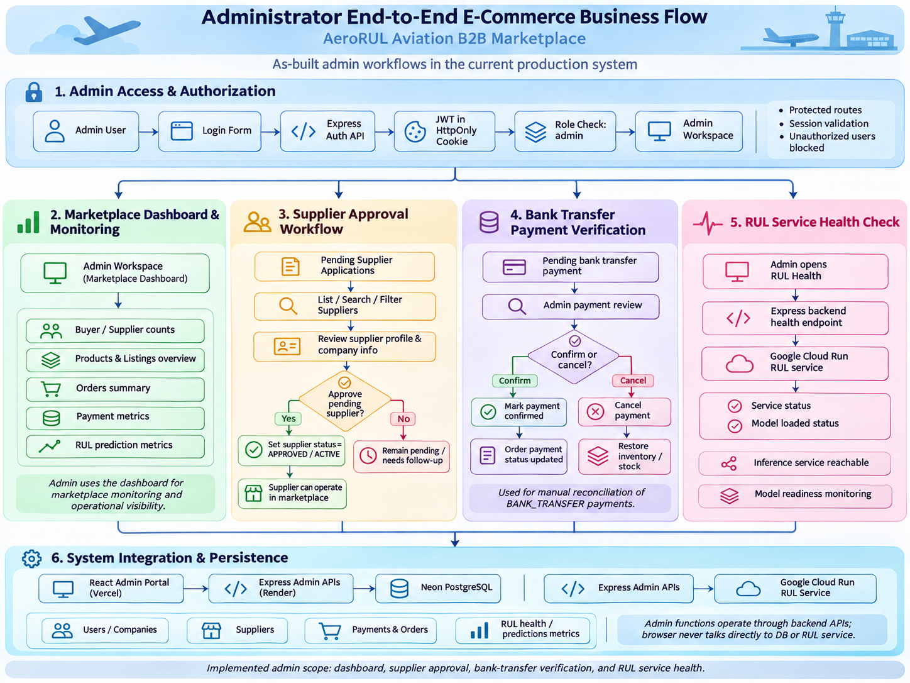

# Admin Integration

The Admin portal connects **React 18 (Vercel)** $\to$ **Express 5 (Render)** $\to$ **Neon PostgreSQL** and **Google Cloud Run (FastAPI RUL)**. Every `/api/v1/admin/*` route is protected by `requireAdmin` (`backend/src/middleware/require-admin.js`), enforcing an authenticated `HttpOnly` JWT cookie (`aerorul_session`), `role === 'ADMIN'`, and CSRF validation (`X-AeroRUL-Request: 1` + `PUBLIC_WEB_URL` `Origin`) on mutations.

## 1. End-to-End Business Flow Overview



| Stage | Scope in Implemented Admin Workspace |
|---|---|
| **1. Admin Access & Authorization** | Sign in via `/login` (`POST /api/v1/auth/login`) $\to$ Express verifies Argon2id hash and sets `aerorul_session` $\to$ `ProtectedRoute roles={["ADMIN"]}` + `requireAdmin` unlock Admin screens and block non-Admin users (`403 ADMIN_REQUIRED`). |
| **2. Marketplace Dashboard & Monitoring** | `AdminDashboardLive` calls `GET /api/v1/admin/dashboard/summary` for live Neon PostgreSQL aggregates (`buyers`, `suppliers_total/pending/approved`, `products_active`, `listings_active`, `orders_total`, `payments_pending`, `succeeded_payment_volume_usd`, `predictions_today`, `last_prediction`, active `model_version`, and 6-month `sales_trend`). |
| **3. Supplier Approval Workflow** | `AdminSuppliersLive` lists, paginates, and searches `public.suppliers` + `companies` + primary contact (`PENDING` \| `APPROVED` \| `SUSPENDED`) and atomically approves `PENDING` suppliers (`POST /suppliers/:supplierId/approve` $\to$ `APPROVED`). |
| **4. Bank Transfer Payment Verification** | `AdminPaymentsLive` reviews `BANK_TRANSFER` records (`PENDING` \| `SUCCEEDED` \| `CANCELLED` \| `ALL`) using `orders.order_number` as the transfer reference, and either **confirms** (`PENDING -> SUCCEEDED` + `paid_at`) or **cancels** (`PENDING -> CANCELLED` + atomic stock restoration). |
| **5. RUL Service Health Check** | `AdminRULHealthLive` triggers `GET /api/v1/admin/rul/health`, where Express probes Cloud Run FastAPI `GET /health` with server-side `RUL_SERVICE_TOKEN` and reports `{ status, model_loaded }` (`healthy` / `degraded` / `unavailable`). |
| **6. System Integration & Persistence** | Browser talks strictly to same-origin `/api/v1/admin/*` via Vercel rewrites; Express acts as sole gateway to Neon PostgreSQL and Google Cloud Run (neither DB credentials nor `RUL_SERVICE_TOKEN` reach React). |

> [!NOTE]
> **Diagram Clarity Notes:**
> - **Supplier Approval Status (Stage 3):** In PostgreSQL (`chk_suppliers_status`), supplier profile status transitions from `'PENDING'` to `'APPROVED'` (not `'ACTIVE'`, which belongs to `seller_listings.status`). Leaving a supplier pending requires no API write.
> - **Dashboard Isolation (Stage 2 vs. Stage 5):** Dashboard prediction metrics reflect persisted Neon rows only and do not imply live Cloud Run container readiness; use Stage 5 (`GET /api/v1/admin/rul/health`) to probe Cloud Run.

---

## 2. Source Organization & Frontend Routes

```text
backend/src/
  server.js                   # Mounts /api/v1/admin/{payments,suppliers,dashboard,rul} with requireAdmin
  middleware/require-admin.js # requireAuth -> role === 'ADMIN' -> requireTrustedMutation
  routes/admin/
    dashboard.routes.js       # GET /api/v1/admin/dashboard/summary
    suppliers.routes.js       # GET / & POST /:supplierId/approve
    payments.routes.js        # GET /, POST /:orderId/confirm & /:orderId/cancel
    rul-health.routes.js      # GET /api/v1/admin/rul/health
  controllers/admin/          # Query/ID validation & HTTP responses
  services/admin/             # Business logic, 4s Cloud Run health proxy & *.repository.js SQL

frontend/src/
  layouts/AdminLayout.jsx     # Shared Admin sidebar, mobile drawer, breadcrumb & Sign Out
  features/admin/services/
    adminApi.js               # Admin HTTP client (/v1/admin/*, credentials: "include", CSRF header)
  services/adminService.js    # Re-export facade
  screens/admin/
    AdminDashboardLive.jsx
    AdminSuppliersLive.jsx
    AdminPaymentsLive.jsx
    AdminRULHealthLive.jsx
```

Legacy static reference files under `frontend/src/screens/admin/Admin_frontend_Code/` are not routed by `frontend/src/app/router.jsx`; all live Admin pages render under `ProtectedRoute` (`roles={["ADMIN"]}`) and `AdminLayout`:

| Frontend Route | Screen / Redirect | Purpose |
|---|---|---|
| `/admin` | Redirect $\to$ `/admin/dashboard` | Default Admin landing route |
| `/admin/dashboard` | `AdminDashboardLive` | Platform KPIs and 6-month `SUCCEEDED` USD payment volume series |
| `/admin/suppliers` | `AdminSuppliersLive` | Review supplier profiles and approve `PENDING` applications |
| `/admin/payments` | `AdminPaymentsLive` | Confirm or cancel `BANK_TRANSFER` payments |
| `/admin/rul-health` | `AdminRULHealthLive` | On-demand FastAPI RUL service connectivity & model-load check |
| `/admin/moderation`, `/admin/rul-status`, `/admin/recommendations` | Redirects | Legacy alias redirects to `/admin/suppliers`, `/admin/rul-health`, `/admin/dashboard` |

---

## 3. API Routes (`/api/v1/admin`, Role: `ADMIN`)

| Domain | Method | Route | Purpose & Key Parameters / Constraints |
|---|---|---|---|
| **Dashboard** | `GET` | `/dashboard/summary` | Returns buyer/supplier/product/listing/order/payment/RUL counts and 6-month `sales_trend` |
| **Suppliers** | `GET` | `/suppliers` | `?status=PENDING\|APPROVED\|SUSPENDED&page=1&limit=10&search=` (max 120 chars; `limit` 1–100) |
| | `POST` | `/suppliers/:supplierId/approve` | Atomic `PENDING -> APPROVED` transition; returns `{ supplier_id, status, already_approved }` |
| **Payments** | `GET` | `/payments` | `?status=PENDING\|SUCCEEDED\|CANCELLED\|ALL&page=1&limit=10` (lists `BANK_TRANSFER` only) |
| | `POST` | `/payments/:orderId/confirm` | Transitions `PENDING` `BANK_TRANSFER` $\to$ `SUCCEEDED` + sets `paid_at` (idempotent if `SUCCEEDED`) |
| | `POST` | `/payments/:orderId/cancel` | Transitions `PENDING` `BANK_TRANSFER` $\to$ `CANCELLED` + restores stock (idempotent if `CANCELLED`) |
| **RUL Health** | `GET` | `/rul/health` | Express-proxied check to FastAPI `GET /health` returning `{ status, model_loaded }` |

---

## 4. Governance, Transactions & Security Guarantees

- **Supplier Approval (`suppliers.repository.js`):** Uses conditional SQL `UPDATE public.suppliers SET status = 'APPROVED' WHERE supplier_id = $1 AND status = 'PENDING'`. Repeated calls on `APPROVED` return `200` (`already_approved: true`); `SUSPENDED` suppliers return `409 SUPPLIER_STATUS_CONFLICT` and are never silently reactivated.
- **Bank Transfer Reconciliation (`payments.repository.js`):**
  - Lists and operates on `payment_method = 'BANK_TRANSFER'` only (`SIMULATION` orders return `409 INVALID_PAYMENT_METHOD`).
  - **Confirm:** Locks `payments` (`FOR UPDATE OF p`); sets `status = 'SUCCEEDED', paid_at = CURRENT_TIMESTAMP`, unblocking Supplier fulfillment (`CANCELLED` returns `409 PAYMENT_ALREADY_CANCELLED`).
  - **Cancel:** Locks `payments` and `seller_orders`, rejects orders already progressed past `CONFIRMED` (`409 ORDER_ALREADY_IN_FULFILLMENT`), sets `status = 'CANCELLED', paid_at = NULL`, and restores reserved `seller_listings.stock_quantity` per aggregated `order_items` in the same PostgreSQL transaction (`already_cancelled: true, stock_restored: false` on replay so stock is never restored twice).
- **RUL Health Proxy (`rul-health.service.js`):** Requires HTTPS for remote Cloud Run URLs (HTTP permitted only on local/private hosts), `RUL_SERVICE_TOKEN` $\ge 32$ ASCII chars, `redirect: "error"`, `AbortSignal.timeout(4000)`, and $\le 4096$-byte JSON body; returns `{ status: "unavailable", model_loaded: false }` gracefully when offline or misconfigured.

---

## 5. Verification & API Documentation

- **API Reference:** View live docs at `https://www.aerotradehub.top/docs/` or build locally from `backend/` via `npm run doc` (`backend/docs/apidoc/`).
- **Production Acceptance:** Admin dashboard metrics, Supplier approval, `BANK_TRANSFER` confirm/cancel reconciliation, and Cloud Run RUL health monitoring passed verification at `https://www.aerotradehub.top` on **November 16, 2026**.
