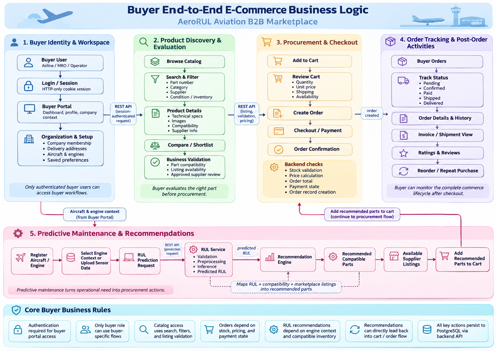

# Buyer Integration

The Buyer workspace connects **React 18 (Vercel)** $\to$ **Express 5 (Render)** $\to$ **Neon PostgreSQL** and **Google Cloud Run (FastAPI RUL)**. All `/api/v1/*` Buyer endpoints require an authenticated `HttpOnly` JWT session cookie (`aerorul_session`) with `role === 'BUYER'` enforced by `requireBuyer`; identity and `company_id` are always resolved server-side, and writes require `X-AeroRUL-Request: 1` plus a matching `PUBLIC_WEB_URL` `Origin`.

## 1. End-to-End Business Logic Overview



| Stage | Scope in Implemented Buyer Workspace |
|---|---|
| **1. Buyer Identity & Workspace** | `BUYER` session via `aerorul_session` cookie (`GET /auth/me`), Dashboard metrics (`/buyer` / `/buyer/dashboard`), company membership, saved delivery addresses (`checkout_addresses`), and registered aircraft/engines. |
| **2. Product Discovery & Evaluation** | Public catalog browsing, search/filters, product detail, specs, images, engine compatibility metadata, and approved-supplier offer comparison (`/marketplace`, `/marketplace/products/:productId`). |
| **3. Procurement & Checkout** | Shared `cart` (`GET/POST/PUT/DELETE /cart*`), shipping/payment selection (`/checkout/*`), server delivery estimates, and single-transaction `POST /checkout/orders` (`SIMULATION` or `BANK_TRANSFER`) creating `orders`, `seller_orders`, `order_items`, and `payments`. |
| **4. Order Tracking & Post-Order** | Company-scoped `/orders`, `/orders/:orderId`, and `/orders/:orderId/confirmation` displaying line-item snapshots, payment method/status badge, and seller-order progress (`CONFIRMED -> PROCESSING -> SHIPPED -> DELIVERED`). |
| **5. Predictive Maintenance & Replace & Buy** | Company aircraft/engine CRUD $\to$ raw FD002 `text/csv` upload + `X-RUL-Source` $\to$ Cloud Run RUL inference + single-TX save (`sensor_uploads`, `rul_predictions`) $\to$ ranked compatible `ENGINE` replacement listings (`max 5`) added directly to the shared cart. |

> [!NOTE]
> **Diagram vs. Current MVP Scope Clarifications:**
> - **Replace & Buy Target:** Stage 5 labels *Recommended Compatible Parts*; the implemented MVP recommends whole replacement **`ENGINE` listings** using exact `product_engine_compatibility` evidence, approved supplier status, and positive stock (max 5).
> - **Conceptual Post-Order / Preference Items:** Stage 4 shows `Ratings & Reviews`, `Reorder`, and `Invoice` as broader marketplace concepts, and Stage 1 shows `Saved preferences`. In the implemented runtime, `wishlist_items` and `reviews` exist in the PostgreSQL schema (with Dashboard displaying wishlist count), while dedicated buyer UI routes for wishlist management, ratings/reviews submission, one-click reorder, or tax invoices are not mounted.

---

## 2. Source Organization & Frontend Routes

```text
backend/src/
  middleware/require-buyer.js          # requireAuth -> BUYER role -> requireTrustedMutation
  routes/buyer/                        # cart, checkout, orders, dashboard, engines, rul routers
  controllers/buyer/                   # Validation & HTTP responses
  services/buyer/                      # Business rules & colocated *.repository.js SQL modules

frontend/src/
  layouts/BuyerLayout.jsx              # Shared Buyer shell & navigation
  services/buyerApi.js                 # Cookie + X-AeroRUL-Request transport (/api/v1)
  auth/AuthContext.jsx                 # Session context via GET /api/v1/auth/me
  features/buyer/                      # Reusable Buyer hooks, components & API adapters
  screens/buyer/                       # BuyerDashboard, MyEngines, EngineDetail, RULAnalysis, Cart, Checkout*, Orders*
```

`frontend/src/app/router.jsx` mounts all Buyer pages under `ProtectedRoute` (`roles={["BUYER"]}`) and `BuyerLayout`:

| Frontend Route | Screen | Purpose |
|---|---|---|
| `/buyer`, `/buyer/dashboard` | `BuyerDashboard` | Company engine/order counts, wishlist count, recent orders & critical RUL alerts |
| `/buyer/engines`, `/buyer/engines/:engineId` | `MyEngines`, `EngineDetail` | Register/edit company engines & view stored predictions and upload metadata |
| `/buyer/rul` | `RULAnalysis` | Submit FD002 CSV (`text/csv`), inspect urgency, and generate Replace & Buy offers |
| `/cart` | `CartPage` | Manage shared cart items across Path A (catalog) and Path B (recommendations) |
| `/checkout/shipping`, `/checkout/payment`, `/checkout/review` | `CheckoutShippingPage`, `CheckoutPaymentPage`, `CheckoutReviewPage` | Address/delivery selection, `SIMULATION` / `BANK_TRANSFER` selection & order review |
| `/orders`, `/orders/:orderId`, `/orders/:orderId/confirmation` | `OrdersPage`, `OrderDetailPage`, `OrderConfirmationPage` | Company order list, fulfillment/payment detail, and confirmation summary (`/buyer/orders` redirects to `/orders`) |

---

## 3. API Routes (`/api/v1`, Role: `BUYER`)

All routes require a signed-in `BUYER` session; state-changing requests additionally require `X-AeroRUL-Request: 1` and trusted `Origin`.

| Domain | Method | Route | Purpose |
|---|---|---|---|
| **Cart** | `GET` | `/cart` | Get the authenticated user's cart |
| | `POST` | `/cart/items` | Add a supplier listing (`listing_id`, `quantity`) after checking active/approved stock |
| | `PUT` | `/cart/items/:cartItemId` | Update an owned cart item's quantity |
| | `DELETE` | `/cart/items/:cartItemId` | Remove an owned cart item |
| | `DELETE` | `/cart` | Clear the authenticated user's cart |
| **Checkout** | `GET` | `/checkout/addresses` | List company saved addresses |
| | `POST` | `/checkout/addresses` | Create a company saved address (2-letter ISO `country_code`) |
| | `GET` | `/checkout/delivery-methods` | Get demonstration delivery fee estimates |
| | `GET` | `/checkout/company` | Get authenticated Buyer company profile |
| | `POST` | `/checkout/orders` | Execute single-TX order placement from cart (`checkout_key` idempotency) |
| **Orders** | `GET` | `/orders` | Search/filter company orders |
| | `GET` | `/orders/:orderId` | Get company-scoped order detail |
| | `GET` | `/orders/:orderId/confirmation` | Get company-scoped order confirmation |
| **Dashboard** | `GET` | `/dashboard/summary` | Get company engine/order counts, wishlist count & critical RUL summary |
| | `GET` | `/dashboard/engine-health` | List company engines and latest stored predictions |
| | `GET` | `/dashboard/recent-orders` | List recent company orders |
| **Engines** | `GET` | `/engines` | Search/filter company-owned engines |
| | `GET` | `/engines/models` | Search available catalog `engine_models` |
| | `GET` | `/engines/aircraft` | List company-owned `aircraft` |
| | `POST` | `/engines` | Register a new company engine (existing or new aircraft) |
| | `GET` | `/engines/:engineId` | Get company-scoped engine detail |
| | `PUT` | `/engines/:engineId` | Update company-owned engine details |
| | `GET` | `/engines/:engineId/sensor-uploads` | List private upload metadata for an owned engine |
| **RUL & Recs** | `POST` | `/rul/engines/:engineId/predict` | Run FastAPI FD002 inference (`raw text/csv`, `X-RUL-Source`, `Idempotency-Key`) and persist upload + prediction |
| | `GET` | `/rul/engines/:engineId/history` | List stored RUL prediction history without running inference |
| | `POST` | `/rul/predictions/:predictionId/recommendations` | Generate and persist up to 5 compatible replacement `ENGINE` listings |
| | `GET` | `/rul/predictions/:predictionId/recommendations` | Read saved replacement `ENGINE` recommendation snapshots |

---

## 4. Checkout, Payment & RUL Boundaries

- **Single-TX Checkout & Payment MVP:** `POST /api/v1/checkout/orders` atomically validates addresses, active listings/approved suppliers, locks/decrements `seller_listings.stock_quantity`, inserts `orders` $\to$ `seller_orders` $\to$ `order_items` snapshots $\to$ `payments`, and clears purchased cart items using `checkout_key` idempotency:
  - `SIMULATION`: Immediately records `payments.status = 'SUCCEEDED'` with `paid_at`.
  - `BANK_TRANSFER`: Records `PENDING` (`paid_at = NULL`, transfer reference `orders.order_number`). Supplier fulfillment stays blocked until Admin runs `/confirm` (or `/cancel`, restoring stock once). No cardholder data, banking rails, real funds, or taxes are processed.
  - Detailed specs: [PAYMENT_MVP_CONTRACT.md](./PAYMENT_MVP_CONTRACT.md) · [PAYMENT_MVP_QA_CHECKLIST.md](./PAYMENT_MVP_QA_CHECKLIST.md).
- **RUL CSV Input & Persistence:** Accepts UTF-8 `text/csv` ($\le 1$ MiB, 19 required columns, single unit, $\ge 30$ rows, no ground-truth RUL column) plus user-declared `X-RUL-Source` (`NASA_CMAPSS_FD002`, `CUSTOM_SYNTHETIC`, or `EXTERNAL_MAPPED`). Express calls Google Cloud Run FastAPI (`POST /v1/predict`, no open DB transaction during HTTP call), then saves `sensor_uploads` + `rul_predictions` in Neon PostgreSQL and stages raw CSV under `backend/storage/rul/` (ephemeral on Render Free).
- **Academic & Safety Disclaimer:** Predictions use a frozen NASA C-MAPSS FD002 Condition-Aware iTransformer and 20/40/80-cycle demo urgency labels (`PRIORITIZE` / `PREPARE` / `MONITOR` / `NORMAL`). Compatibility evidence may carry `is_demo = TRUE` and is **not** FAA/EASA certification or real-aircraft airworthiness guidance. Trade-in, buyback, and valuation are out of scope.

---

## 5. Verification & API Documentation

- **API Reference:** View live docs at `https://www.aerotradehub.top/docs/` or generate locally in `backend/` via `npm run doc` (`backend/docs/apidoc/`).
- **Audit & Testing:** Source-verified endpoint mapping is recorded in [BUYER_API_CONTRACT_AUDIT.md](./BUYER_API_CONTRACT_AUDIT.md). Offline unit tests run without a live database; full end-to-end production testing (Buyer auth, engines, RUL via Cloud Run, Replace & Buy, cart, checkout, and payments) passed at `https://www.aerotradehub.top` on **November 16, 2026**.
