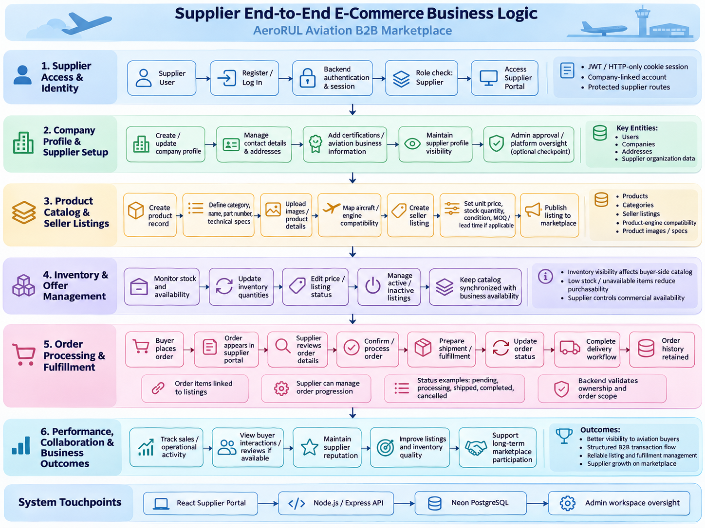

# Supplier Integration

The Supplier portal connects **React 18 (Vercel)** $\to$ **Express 5 (Render)** $\to$ **Neon PostgreSQL**. Every `/api/v1/supplier/*` endpoint requires an authenticated `HttpOnly` JWT cookie (`aerorul_session`), `role === 'SUPPLIER'`, **and** `suppliers.status === 'APPROVED'` enforced by `requireSupplier`; `supplier_id` is always resolved server-side via `company_id`, and writes require `X-AeroRUL-Request: 1` plus a trusted `PUBLIC_WEB_URL` `Origin`.

## 1. End-to-End Business Logic Overview



| Stage | Scope in Implemented Supplier Workspace |
|---|---|
| **1. Supplier Access & Identity** | Register (`POST /auth/register`, `account_type: "SUPPLIER"`) or sign in (`POST /auth/login`) with `HttpOnly` cookie session (`aerorul_session`), company-linked user account, and `requireSupplier` route protection. |
| **2. Company & Supplier Approval** | Registration atomically creates `companies`, `users`, and a **`PENDING`** `suppliers` row. Frontend `SupplierApprovalGate` probes `GET /api/v1/supplier/overview`; Admin approval (`PENDING -> APPROVED`) unlocks the workspace. |
| **3. Seller Listings (`seller_listings`)** | Create and edit supplier offers referencing existing active catalog products (`products.is_active = TRUE`): `product_id`, `seller_sku`, `condition`, USD `price`, `stock_quantity`, `lead_time_days`, and `status` (`DRAFT` \| `ACTIVE` \| `HIDDEN`). |
| **4. Inventory & Offer Management** | Summarize stock levels on `seller_listings` (`in_stock` > 5, `low_stock` 1–5, `out_of_stock` = 0), update `stock_quantity` via `PATCH /inventory/:listingId`, or soft-hide listings (`DELETE /listings/:listingId` sets `status = 'HIDDEN'`). |
| **5. Order Processing & Fulfillment** | View incoming `seller_orders` with snapshotted `order_items`, `buyer_name`, totals, and linked `payments` state; advance fulfillment strictly one step (`CONFIRMED -> PROCESSING -> SHIPPED -> DELIVERED`) once payment is `SUCCEEDED`. |
| **6. Overview & Operational Touchpoints** | `SupplierHome` (`GET /overview`) summarizes listing visibility/stock and order progression counters; all mutations persist in Neon PostgreSQL under Admin oversight (supplier approval & bank-transfer reconciliation). |

> [!NOTE]
> **Diagram vs. Current Runtime Implementation Clarifications:**
> - **Mandatory Approval (Stage 2):** Admin approval is **mandatory**, not optional. Pending suppliers receive `403 SUPPLIER_NOT_APPROVED` until an `ADMIN` approves them; supplier profile edits, certifications upload, and supplier address-book CRUD endpoints are not exposed in the MVP.
> - **Catalog Boundary (Stage 3):** Suppliers manage **`seller_listings`** against pre-seeded/existing catalog `products` — endpoints for Suppliers to create new `products`, upload `product_images`, edit `product_engine_compatibility`, or configure `MOQ` do not exist.
> - **Listing & Order Enum Values (Stages 4–5):** Listing statuses are `DRAFT`, `ACTIVE`, and `HIDDEN` (no `INACTIVE`). Order statuses start at `CONFIRMED` and step strictly through `PROCESSING -> SHIPPED -> DELIVERED` (no `pending`/`completed`/`cancelled` order states; blocked with `409` if linked payment is not `SUCCEEDED`).
> - **Analytics / Reviews (Stage 6):** Overview exposes live listing and order counts; buyer review/rating moderation or reputation scoring endpoints are schema-only and not mounted.

---

## 2. Source Organization & Frontend Routes

```text
backend/src/
  middleware/require-supplier.js  # resolveAuthenticatedUser -> SUPPLIER role -> APPROVED check -> CSRF
  routes/supplier/
    index.js                      # Mounts overview, listings, inventory, orders with requireSupplier
    overview.routes.js            # GET /api/v1/supplier/overview
    listings.routes.js            # Listing CRUD + soft hide
    inventory.routes.js           # Inventory summary + stock update
    orders.routes.js              # Incoming seller_orders + status transition
  controllers/supplier/           # Payload validation & conflict mapping
  services/supplier/              # Parameterized SQL scoped by req.supplierId

frontend/src/
  layouts/SupplierLayout.jsx      # Shared Supplier workspace navigation & AccountActions
  auth/ProtectedRoute.jsx         # SupplierApprovalGate calling checkSupplierApproval()
  features/supplier/
    api.js                        # supplierRequest transport (VITE_SUPPLIER_DEMO_MODE flag)
    overview/                     # OverviewCards + overviewApi
    listings/                     # listingApi, listingValidation, ProductSelector, HideListingButton
    inventory/                    # inventoryApi, StockEditor
    orders/                       # orderApi, OrderStatusButton
  services/                       # supplierService.js, supplierOrderService.js
  screens/supplier/               # SupplierHome, SupplierListings, SupplierListingForm, SupplierInventory, SupplierOrders*
```

`frontend/src/app/router.jsx` mounts all Supplier screens under `ProtectedRoute` (`roles={["SUPPLIER"]} requireSupplierApproval`) and `SupplierLayout`. Production Vercel sets `VITE_SUPPLIER_DEMO_MODE=false` so all requests hit the live `/api/v1/supplier/*` endpoints (instead of `frontend/src/mocks/`).

| Frontend Route | Screen | Purpose |
|---|---|---|
| `/supplier` | `SupplierHome` | Workspace overview cards (listing visibility/stock & order counts) |
| `/supplier/listings` | `SupplierListings` | List owned offers and soft-hide listings (`ACTIVE` / `DRAFT` $\to$ `HIDDEN`) |
| `/supplier/listings/new` | `SupplierListingForm` | Create a new offer linked to an active catalog product |
| `/supplier/listings/:listingId/edit` | `SupplierListingForm` | Edit an existing owned listing |
| `/supplier/inventory` | `SupplierInventory` | Monitor stock health and update `stock_quantity` |
| `/supplier/orders` | `SupplierOrders` | View incoming buyer seller orders and linked payment states |
| `/supplier/orders/:sellerOrderId` | `SupplierOrderDetail` | Inspect line-item snapshots and advance fulfillment status |

---

## 3. API Routes (`/api/v1/supplier`, Role: `SUPPLIER` + `APPROVED`)

All mutations (`POST`, `PATCH`, `DELETE`) require `X-AeroRUL-Request: 1` and matching `PUBLIC_WEB_URL` `Origin`.

| Domain | Method | Route | Purpose |
|---|---|---|---|
| **Overview** | `GET` | `/overview` | Approval probe + owned listing (`total`, `active`, `draft`, `hidden`, `in_stock`, `low_stock`, `out_of_stock`) & `seller_order` counts |
| **Listings** | `GET` | `/listings` | List all owned `seller_listings` (`DRAFT`, `ACTIVE`, `HIDDEN`) |
| | `GET` | `/listings/:listingId` | Retrieve one owned listing joined with product metadata |
| | `POST` | `/listings` | Create listing for an active product (`products.is_active = TRUE`) |
| | `PATCH` | `/listings/:listingId` | Partial update of allowed listing fields (rejects unknown keys & `product_id` inactive) |
| | `DELETE` | `/listings/:listingId` | Soft-hide listing (`status = 'HIDDEN'`, preserves order history) |
| **Inventory** | `GET` | `/inventory` | Stock summary counters and owned items sorted by product name |
| | `PATCH` | `/inventory/:listingId` | Update `stock_quantity` (`0..2147483647`; single-field JSON body required) |
| **Orders** | `GET` | `/orders` | List owned `seller_orders` with `order_items` snapshots & payment status |
| | `GET` | `/orders/:sellerOrderId` | Retrieve one owned `seller_order` with line items and totals |
| | `PATCH` | `/orders/:sellerOrderId/status` | Advance fulfillment one step (`PROCESSING`, `SHIPPED`, `DELIVERED`) |

---

## 4. Validation, Approval & Fulfillment Rules

- **Listing Validation (`listings.controller.js`):** Strict allowlist (`product_id`, `seller_sku` 1–100 chars unique per supplier $\to$ `409 DUPLICATE_SKU`, `condition`: `NEW|USED|REFURBISHED`, `price`: `^(0|[1-9]\d{0,15})(\.\d{1,2})?$`, `stock_quantity` & `lead_time_days`: INT `0..2147483647`, `status`: `DRAFT|ACTIVE|HIDDEN`).
- **Payment-Gated Fulfillment (`orders.controller.js`, `orders.service.js`):**
  1. Linked `payments.status` **must** be `'SUCCEEDED'` (`PENDING` returns `409 PAYMENT_PENDING`; `CANCELLED` returns `409 PAYMENT_CANCELLED`).
  2. Transitions advance strictly one step forward (`CONFIRMED -> PROCESSING -> SHIPPED -> DELIVERED`, recording `processing_at` on `PROCESSING`) using conditional `UPDATE ... WHERE so.status = $3 AND p.status = 'SUCCEEDED'` (`409 ORDER_CHANGED` on race). No separate `/shipment` endpoint exists.

---

## 5. Verification & API Documentation

- **API Reference:** View live docs at `https://www.aerotradehub.top/docs/` or build locally from `backend/` via `npm run doc` (`backend/docs/apidoc/`).
- **Production Acceptance:** Verified end-to-end (Supplier login, Admin approval, listing/inventory updates, and order fulfillment after `BANK_TRANSFER` confirmation) at `https://www.aerotradehub.top` on **November 16, 2026**.
