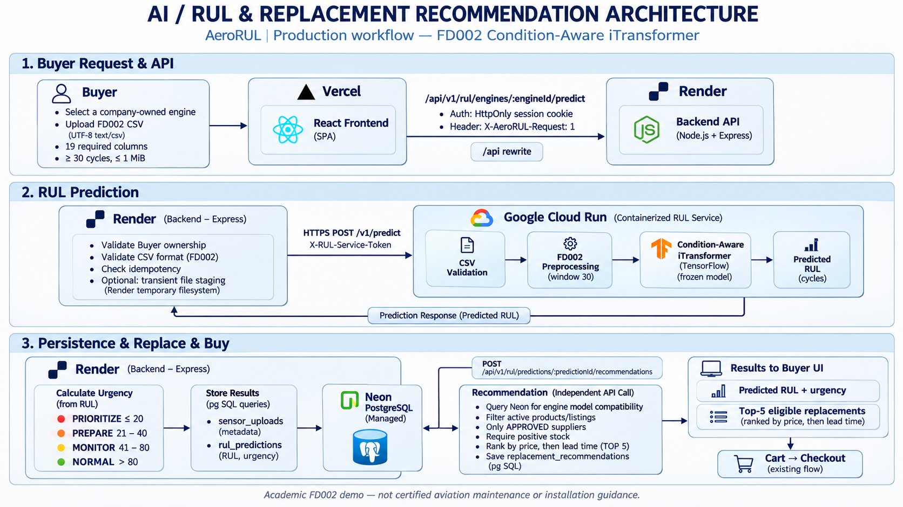

# AeroRUL AI/RUL Service & Replace & Buy Documentation

Canonical documentation hub for AeroRUL's **FD002 Condition-Aware iTransformer** inference pipeline, **Google Cloud Run** FastAPI container, **Render Express** orchestration, **Neon PostgreSQL** persistence, and **Replace & Buy** recommendation engine.

## 1. Production Architecture Flow



| Stage | Components & Transport | Implemented Runtime Behavior |
|---|---|---|
| **1. Buyer Request & API** | Buyer UI (**Vercel** React SPA) $\to$ **Render** Express API | Buyer selects a company-owned engine at `/buyer/rul` and submits a UTF-8 `text/csv` payload (`19` required columns, $\ge 30$ cycles, $\le 1$ MiB) via same-origin `/api/v1/rul/engines/:engineId/predict` with `HttpOnly` cookie + `X-AeroRUL-Request: 1`. |
| **2. RUL Prediction** | **Render** Express (`BE-08`) $\to$ **Google Cloud Run** (`rul-service/api.py`) | Express validates Buyer company ownership, CSV headers/size, `X-RUL-Source`, and `Idempotency-Key`, stages a private local CSV (ephemeral on Render Free) with **no DB transaction open**, and posts `HTTPS POST /v1/predict` with `X-RUL-Service-Token`. FastAPI validates CSV, applies FD002 window-30 preprocessing + KMeans/z-score normalization, and runs the frozen Condition-Aware iTransformer. |
| **3. Persistence & Replace & Buy** | **Render** Express (`BE-08`/`BE-09`) $\leftrightarrow$ **Neon PostgreSQL** $\to$ Shared Cart | Express maps predicted cycles to demo urgency (`PRIORITIZE <= 20`, `PREPARE 21–40`, `MONITOR 41–80`, `NORMAL > 80`), persists `sensor_uploads` (`VALID`) + `rul_predictions` (`SUCCEEDED`) in one transaction, then serves `POST .../recommendations` to filter active `ENGINE` listings from `APPROVED` suppliers with positive stock matching `product_engine_compatibility` (top 5 ranked by price, lead time, ID) before adding to the Buyer cart. |

---

## 2. Organized Documentation Subfolders

All detailed specifications are grouped into four focused directories under `docs/rul/`:

| Group | Subfolder | Included Documents |
|---|---|---|
| **Architecture & Integration** | `architecture/` | • [`SYSTEM_DESIGN.md`](./architecture/SYSTEM_DESIGN.md) — End-to-end RUL design boundaries, failure isolation & Replace & Buy architecture<br>• [`INTEGRATION_GUIDE.md`](./architecture/INTEGRATION_GUIDE.md) — Express $\leftrightarrow$ FastAPI wiring, headers, and local multi-terminal runbook |
| **Input & Service Contracts** | `contracts/` | • [`CSV_INPUT_SPECIFICATION.md`](./contracts/CSV_INPUT_SPECIFICATION.md) — Required 19-column FD002 telemetry schema, bounds & `X-RUL-Source` classification<br>• [`MODEL_INFERENCE_CONTRACT.md`](./contracts/MODEL_INFERENCE_CONTRACT.md) — Internal FastAPI `/health`, `/v1/model-info`, `/v1/predict` schemas & security rules |
| **Evaluation & Artifact Audit** | `evaluation/` | • [`MODEL_EVALUATION.md`](./evaluation/MODEL_EVALUATION.md) — FD002 benchmark metrics (seed 42 RMSE_125 ~13.94 cycles) & training caveats<br>• [`AUDIT_REPORT.md`](./evaluation/AUDIT_REPORT.md) — Frozen model weight, scaler, layer & SHA-256 package audit |
| **Environment & Local Setup** | `setup/` | • [`SETUP_GUIDE.md`](./setup/SETUP_GUIDE.md) — Python 3.11 `.venv` installation, `7/7` offline unit tests, CLI check & troubleshooting |

---

## 3. Public Express Routes (`/api/v1/rul`, Role: `BUYER`)

Source: `backend/src/routes/buyer/rul.routes.js` & `frontend/src/features/buyer/rul-analysis/services/rulApi.js`.

| Method | Endpoint | Purpose & Key Guarantees |
|---|---|---|
| `POST` | `/api/v1/rul/engines/:engineId/predict` | Accepts raw UTF-8 `text/csv` ($\le 1$ MiB) + `X-AeroRUL-Request: 1`, `Idempotency-Key` (UUID), `X-RUL-Filename`, `X-RUL-Source` (`NASA_CMAPSS_FD002` \| `CUSTOM_SYNTHETIC` \| `EXTERNAL_MAPPED`). Returns `201` on new inference, `200` on identical replay, `409` on idempotency conflict. |
| `GET` | `/api/v1/rul/engines/:engineId/history?limit=10` | Returns persisted RUL prediction history scoped to the logged-in Buyer's `company_id`. |
| `POST` | `/api/v1/rul/predictions/:predictionId/recommendations` | Generates and transactionally stores up to 5 compatible replacement `ENGINE` listings (`READY` \| `NO_MATCH`); repeated calls return the existing saved snapshot. |
| `GET` | `/api/v1/rul/predictions/:predictionId/recommendations` | Reads saved recommendation snapshots without triggering inference or database writes. |

---

## 4. Input Rules, Provenance & Internal FastAPI Quick Start

- **Required CSV Headers (19 columns):** `unit,cycle,setting_1,setting_2,setting_3,sensor_2,sensor_3,sensor_4,sensor_7,sensor_8,sensor_9,sensor_11,sensor_12,sensor_13,sensor_14,sensor_15,sensor_17,sensor_20,sensor_21`. Must contain 1 unit, $\ge 30$ observations, zero label columns, UTF-8 without BOM, max 1 MiB, in raw unscaled physical units.
- **Provenance (`X-RUL-Source`):** User-declared provenance label stored in `sensor_uploads.dataset_subset` (`LEGACY_UNCLASSIFIED` for pre-change rows); `ml_model_versions.dataset_subset` remains `'FD002'` regardless of upload classification.
- **Internal FastAPI (`rul-service/api.py`):** Loads `checkpoints/best_model.weights.h5` + `preprocessing/scaler_artifacts.json` once at worker startup; exposes `GET /health`, `GET /v1/model-info`, and `POST /v1/predict` (`docs_url=None`, requires `X-RUL-Service-Token`, $\ge 32$ chars).

### Run Locally in Two Terminals (Express $\to$ FastAPI on `127.0.0.1:8000`)

```powershell
# Terminal 1 — Internal FastAPI RUL service
Set-Location rul-service
$env:RUL_SERVICE_TOKEN = "<same private 32+ char value>"
.\.venv\Scripts\python.exe -m uvicorn api:app --host 127.0.0.1 --port 8000

# Terminal 2 — Express backend
Set-Location backend
$env:RUL_SERVICE_URL = "http://127.0.0.1:8000"
$env:RUL_SERVICE_TOKEN = "<same private 32+ char value>"
npm run dev
```

*(Production deploys the container via [`rul-service/Dockerfile`](../../rul-service/Dockerfile) to **Google Cloud Run**, called by Render Express over **HTTPS**.)*

---

## 5. Persistence, Storage Boundaries & Scope Limits

- **Neon PostgreSQL Tables:** `ml_model_versions` (seeded via [`03_ml_model_version_seed.sql`](../../database/seed/03_ml_model_version_seed.sql)), `sensor_uploads` (`is_demo=true`, `status='VALID'`), `rul_predictions` (`SUCCEEDED`), and `replacement_recommendations` (`READY` \| `NO_MATCH` \| `FAILED`).
- **Private CSV Filesystem:** Staged under `backend/storage/rul/<user_id>/` (never statically served; ephemeral across Render Free restarts/redeploys while Neon rows remain durable).
- **Academic & Safety Disclaimer:** C-MAPSS units, 20/40/80-cycle urgency rules, and `is_demo` engine compatibility evidence are for academic simulation only — **not** certified FAA/EASA airworthiness or installation advice; do **not** treat as an ensemble or sync `engines.current_cycle` from CSV uploads. Trade-in, buyback, valuation, and exchange credit are out of scope.
- **Verification:** `7/7` offline CPU tests (`rul-service/tests/test_offline_inference.py`), backend/CI checks pass; end-to-end production inference and Replace & Buy on `https://www.aerotradehub.top` passed owner verification on **November 16, 2026**.
