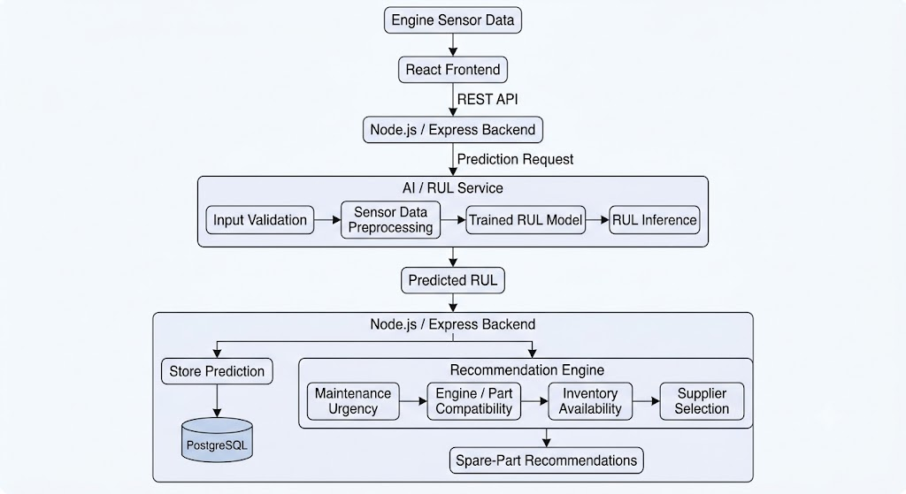

# RUL Service Integration Design

> **Current runtime status:** The approved architecture is implemented as
> React → authenticated Express Buyer API → internal FastAPI HTTP API →
> Condition-Aware iTransformer. Express calls FastAPI over HTTP and persists
> successful results in the existing PostgreSQL schema; FastAPI does not access
> Buyer authentication or the database. The service loads its frozen model and
> scaler once at startup. The standalone Python CLI remains for offline use
> only. The Replace & Buy engine-listing recommendation MVP is implemented;
> trade-in and exchange-credit workflows are not. See the current
> [Buyer RUL runtime contract](./README.md) and
> [REST API documentation](../api/README.md) for authoritative behavior.

## 1. Overview

The Aviation B2B E-Commerce Platform integrates a Remaining Useful Life (RUL)
prediction service with the e-commerce backend.

The RUL service estimates the remaining operating cycles of an aircraft engine.
The current application stores successful predictions, derives a project
demo urgency label, and can persist ranked replacement-engine listings using
explicit compatibility evidence. This does not certify installation
compatibility or determine fair market value.

The RUL model is deployed as an independent service and communicates with the
Node.js / Express backend through a REST API.

## Architecture diagram references

The system diagrams preserve the broader architecture and workflow, including
future recommendation concepts:

- [00 — Master System Architecture](<../architecture/diagrams/System_Design_ver 1.0-00 Master System Architecture.drawio.svg>) — overall system boundary for the RUL workflow.
- [05 — AI/RUL & Recommendation](<../architecture/diagrams/System_Design_ver 1.0-05 AI-RUL & Recommendation.drawio.svg>) — inference pipeline, model input/output, and recommendation process.
- [07 — End-to-End Integration](<../architecture/diagrams/System_Design_ver 1.0-07 End-to-End Integration.drawio.svg>) — end-to-end request flow from UI through business logic to RUL and cart checkout.

See also: [Architecture overview](../architecture/README.md).

## Original System Design and Responsibilities

The original System Design's service boundary is now the implemented runtime:
Express sends validated CSV to an internal FastAPI REST service. The detailed
current endpoint contracts and local startup instructions are in the linked
runtime documentation above. The Replace & Buy recommendation MVP is also
implemented in Express; trade-in, buyback, valuation, and exchange-credit
workflows remain deferred.

## 2. Integration Flow


## 3. Responsibilities

### Node.js / Express Backend

The current backend is responsible for:

- authenticating and authorizing users;
- identifying the aircraft and engine;
- sending prediction requests to the RUL service;
- receiving prediction results;
- storing prediction records;
- deriving the project's demo urgency label;
- generating up to five eligible replacement engine listing recommendations
  from explicit compatibility evidence;
- persisting and returning ranked recommendation snapshots;
- adding selected listings through the existing Buyer Cart API.

Trade-in, buyback, old-asset collection, valuation, and exchange-credit
responsibilities remain future work.

### AI / RUL Service

The RUL service is responsible only for machine-learning inference:

1. Receive engine sensor data.
2. Validate the input.
3. Apply the preprocessing required by the trained model.
4. Run RUL inference.
5. Return the predicted RUL.

The AI service does **not** manage products, suppliers, orders, inventory,
or e-commerce business logic.

## 4. Internal FastAPI REST API

The public React client calls only the authenticated Express Buyer endpoints.
Express sends the raw CSV to FastAPI on the private service network using the
shared `X-RUL-Service-Token`.

| Method | Internal path | Contract |
|---|---|---|
| GET | `/health` | Authenticated readiness status and model-loaded state |
| GET | `/v1/model-info` | Authenticated model metadata and input contract |
| POST | `/v1/predict` | Authenticated raw `text/csv; charset=utf-8` body, maximum 1 MiB |

`POST /v1/predict` requires 19 input columns, unique headers, one unit, at
least 30 observations, no ground-truth labels, and valid numeric data accepted
by the frozen preprocessor. It returns the existing inference result as JSON:

```json
{
  "success": true,
  "model_id": "condition_aware_itransformer_v3",
  "dataset": "NASA_CMAPSS_FD002",
  "predicted_rul_cycles": 19.33,
  "unit": "engine_cycles",
  "input_summary": {
    "engine_id": 1,
    "total_cycles_provided": 30,
    "window_length_used": 30
  }
}
```

Failures use `{ "success": false, "error": { "code": "...", "message": "..." } }`.
The internal FastAPI contract and local service startup are documented in
[`./README.md`](./README.md). It is separate from the public Express
Buyer API and does not receive Buyer identity or connect to PostgreSQL.

The existing FastAPI service reuses the actual inference runner and loads the
frozen model/scaler once per worker at startup. The standalone
`predict_cli.py` is for offline use only.
## 5. Prediction Storage

Successful predictions are stored in the `rul_predictions` table.

The prediction record links:

```text
Engine
  │
  ├── Sensor Upload
  │
  ├── Model Version
  │
  └── Predicted RUL
```

This allows the application to keep prediction history and identify which model
version produced each result.


## Database Mapping

The implemented prediction workflow uses `sensor_uploads`, `rul_predictions`,
and `ml_model_versions`. After successful prediction, the Express
recommendation flow also writes up to five eligible listing snapshots to
`replacement_recommendations`.

```text
sensor_uploads
      │
      │ provides engine sensor data
      ▼
rul_predictions
      │
      │ uses
      ├──────────────► ml_model_versions
      │
      │ produces prediction
      ▼
replacement_recommendations
      │
      │ references available marketplace listings
      ▼
seller_listings
```

### Sensor Upload

`sensor_uploads` represents the sensor dataset submitted for an engine.

It records:

- the target engine;
- the user who uploaded the data;
- the original file information;
- dataset cycle range;
- validation status.

A validated sensor upload can be used as the input source for an RUL prediction.

### Model Version

`ml_model_versions` identifies the exact model configuration used for inference.

It stores information such as:

- model name and version;
- model artifact location;
- preprocessing version;
- sensor schema;
- window size;
- scaler configuration.

This allows predictions to remain traceable when the RUL model changes.

### RUL Prediction

`rul_predictions` connects:

```text
Engine
+
Sensor Upload
+
Model Version
        ↓
Predicted RUL
```

Each prediction records the model and input dataset used to produce the result,
together with the predicted RUL and prediction status.

### Implemented MVP: Replacement Engine Recommendation

After a successful prediction, the Express backend can generate and persist up
to five engine listings. The exact product engine model must match the
prediction's engine model through a `product_engine_compatibility` record.
Only active ENGINE products, active listings, approved suppliers, and positive
stock are eligible. Compatibility evidence may be demo-only and is not
installation certification.

```text
RUL Prediction
        +
Maintenance Urgency
        +
Engine / Part Compatibility
        +
Seller Inventory
        ↓
Replacement Recommendations
```

`replacement_recommendations` stores rank, reason, ranking score, and a
listing snapshot associated with the prediction. Generation locks the
successful prediction row and writes recommendations and recommendation
status in one transaction. Repeated POST requests return saved results;
read-only GET requests do not generate or modify recommendations. Empty
eligibility results set `NO_MATCH`; generation errors may set recommendation
status to `FAILED` without changing the successful prediction status.

Candidates are ranked by lower actual listing price, then shorter lead time,
then ascending listing ID. The stored ranking score is an ordinal rank weight
(`6 - rank_position`), not a compatibility percentage. Prices are listing
prices, not fair-market valuations.

The recommendation engine remains separate from the ML model:

- **RUL Service:** predicts remaining useful life.
- **Express recommendation engine:** applies exact compatibility eligibility
  and transparent listing order.
- **Future trade-in services:** valuation, buyback, old-asset collection, and
  exchange credit are not part of this MVP.


## 6. Replace & Buy Flow and Deferred Trade-In Scope

The implemented Replace & Buy flow surfaces recorded compatible replacement
engine listings after prediction. RUL prediction does not certify
installation compatibility or determine fair market value.

The backend combines the prediction's engine model with recorded
compatibility evidence and marketplace availability:

```text
Predicted RUL
     +
Exact Engine-Model Compatibility Evidence
      +
Seller Inventory
      +
Supplier / Listing Data
      ↓
 Ranked Replacement-Engine Listings
```

The ranked recommendations are persisted and displayed in the Buyer RUL
screen. A selected listing is added through the existing cart API, which
revalidates availability. Trade-in and exchange flows remain deferred.

## 7. Failure Handling

If the RUL service is unavailable or inference fails:

- the request returns an error and does not create a successful prediction;
- no fabricated RUL value is generated;
- existing marketplace functionality remains available;
- the frontend receives an appropriate error response;
- the user may retry the prediction later.

This keeps the AI component isolated from the core e-commerce workflow.

## 8. Scope

This document records the broader system design and current service boundary.
The frozen model, preprocessing, FastAPI inference service, Express
integration, PostgreSQL prediction persistence, and Replace & Buy engine
recommendation MVP are implemented. Trade-in and exchange-credit workflows
remain deferred; see the [current RUL runtime contract](./README.md).
